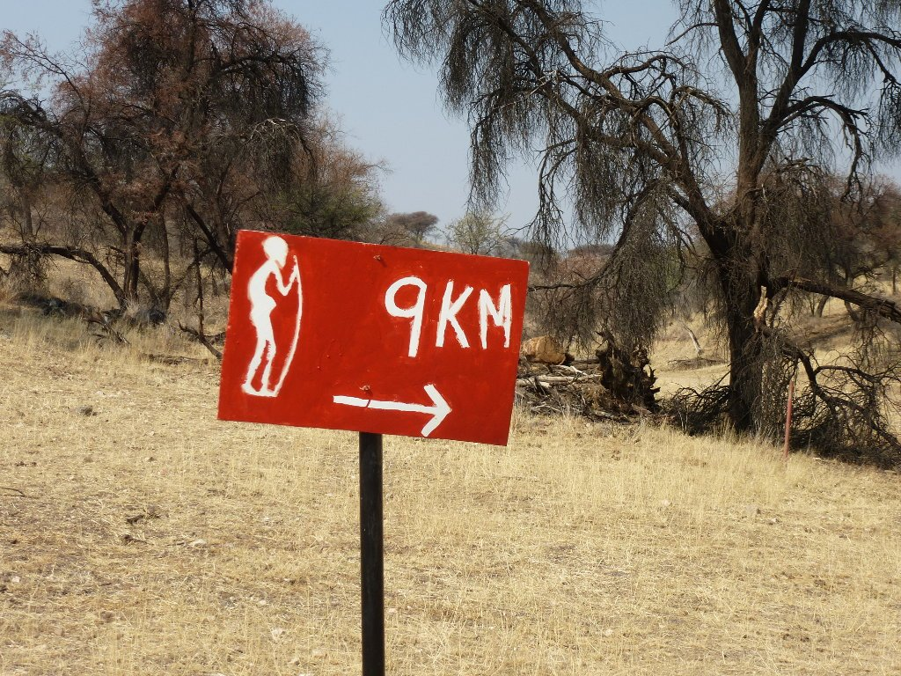
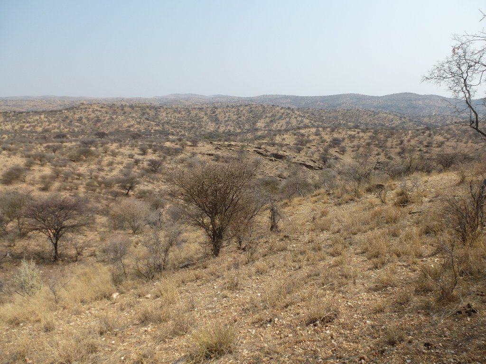
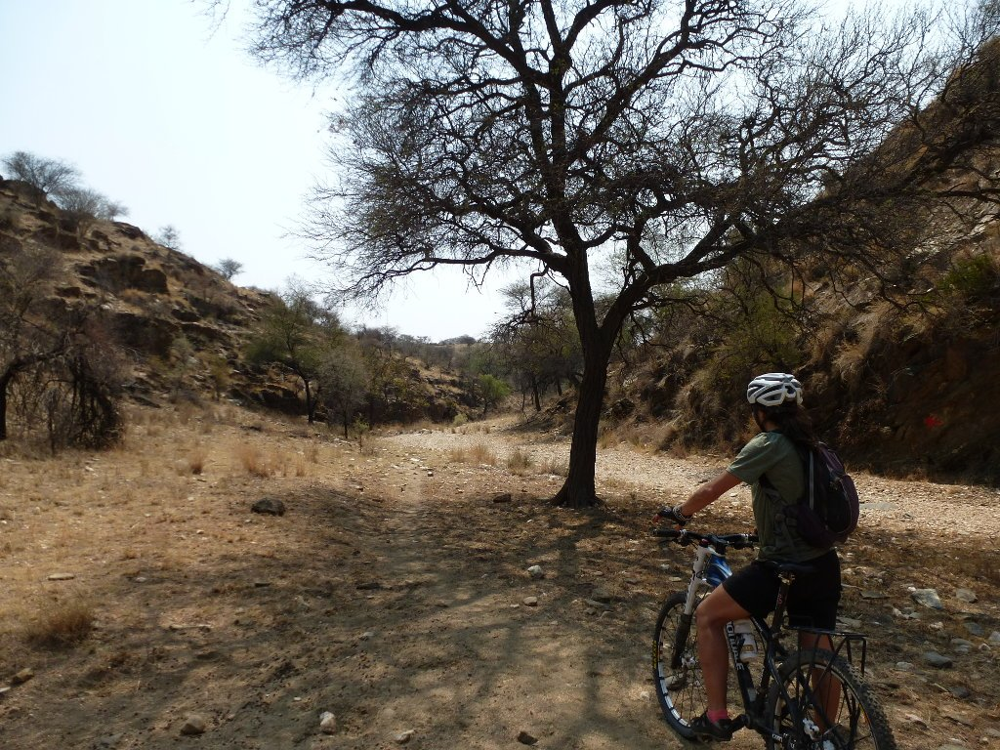
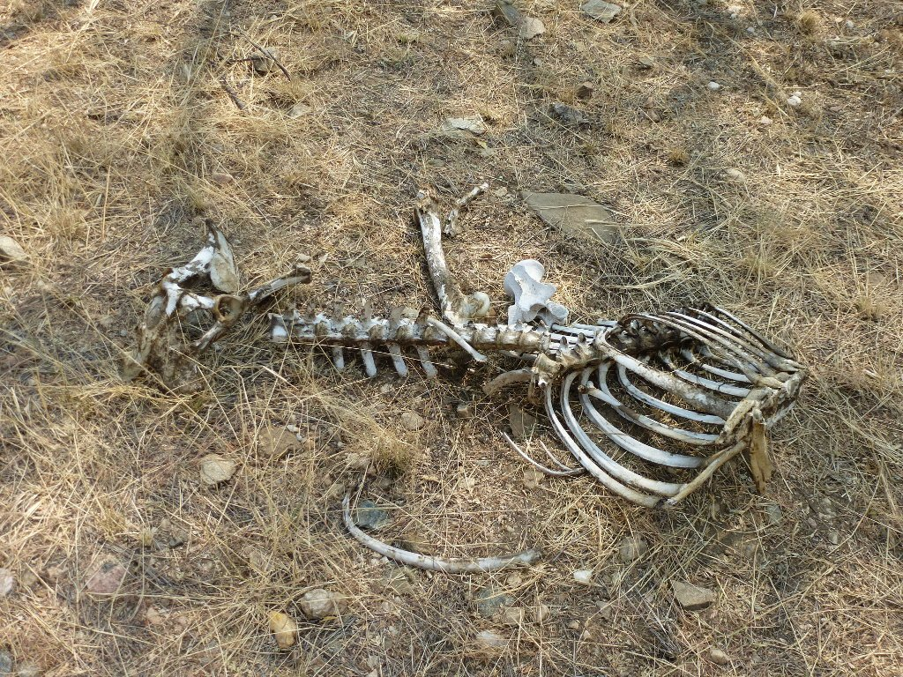
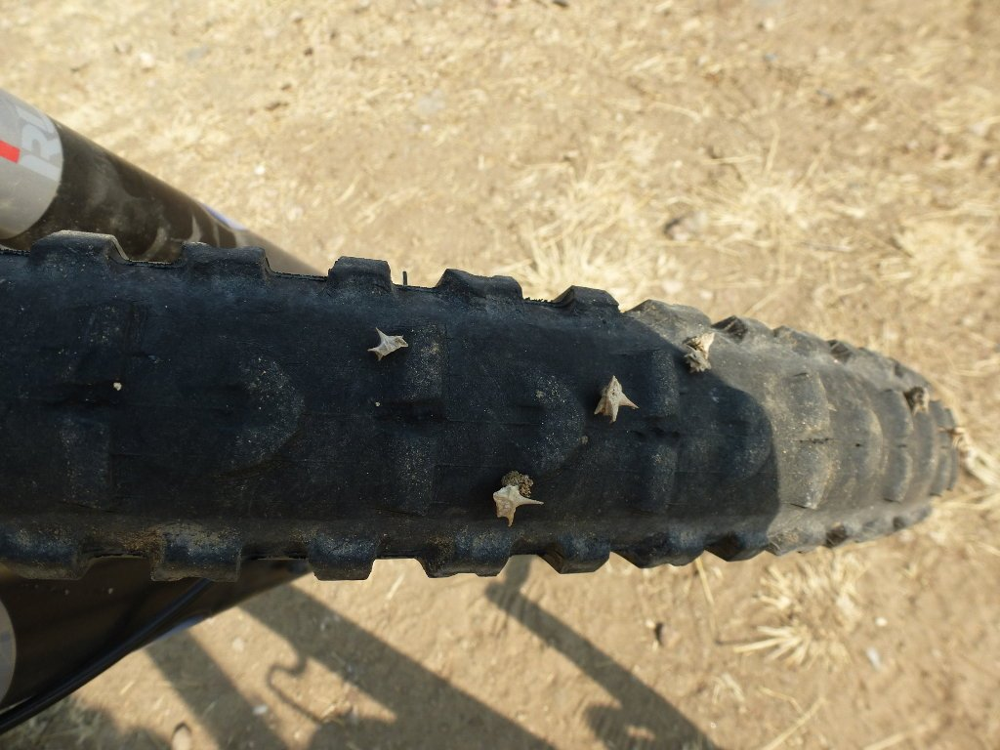
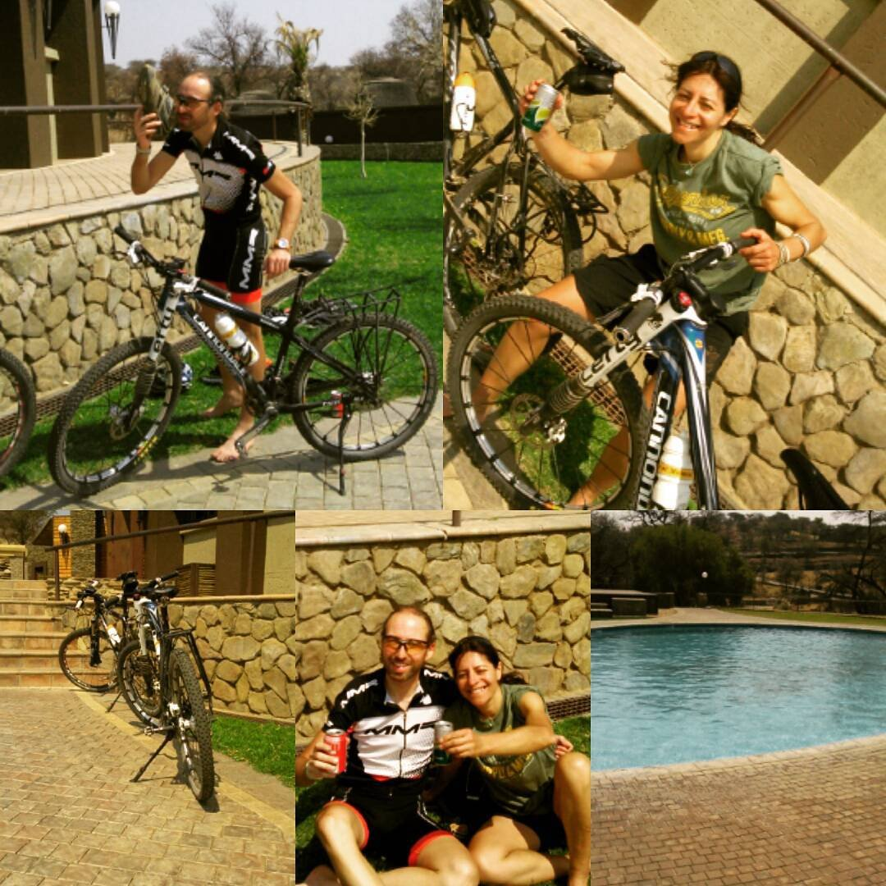

Ya estamos de vuelta en Windhoek, la capital de Namibia. Tras la grata experiencia del kayak con las focas, un autobús nos llevó durante varias horas desde la fresca y agradable costa hasta el caluroso interior. Cuando llegamos a Windhoek, hace ya diez días, no habíamos padecido tanto calor. Y estamos en el invierno austral, no me quiero imaginar los veranos en esta parte del mundo.

Vamos a aprovechar uno de los días que nos quedan antes de volver a España para visitar la reserva natural de Daan Viljoen. Se encuentra a pocos kilómetros de Windhoek y por ello es muy utilizada por los habitantes de esta ciudad para pasar el día y relajarse viendo animales. Tiene buenos accesos por carretera y un buen restaurante con una bonita piscina para los días de calor, más habituales de lo que pensábamos.

Salimos de Windhoek por la mañana temprano, sin alforjas, lo cual agradecemos. Salir rodando de la capital nos permite ver cómo vive la gente más humilde de Windhoek. Atravesamos varios barrios residenciales corrientes hasta llegar a las verdaderas afueras, donde empezamos a ver auténtica pobreza. No esa pobreza que todos tenemos en la mente cuando pensamos en África, pero pobreza al fin y al cabo. Cientos de chabolas de chapa se extienden por las pequeñas colinas que rodean la capital, brillando relucientes bajo los rayos del intenso sol del día de hoy. Y como podéis imaginar, en esta zona no vemos ningún blanco. En Windhoek puedes ver blancos y negros con buena calidad de vida, pero claro, no verás a ningún blanco en una chabola. Aquí los blancos viven entre bien y muy bien.

No tardamos mucho en llegar a Daan Viljoen. La chica que controla la barrera de entrada nos cobra una pequeña cantidad por pasar (las bicis no pagan) y se entretiene charlando en castellano con nosotros. Lo habla bastante bien. Continuamos por la carretera y llegamos al centro de Daan Viljoen, donde se encuentran el camping, restaurante y un bonito lodge. Nos damos un desayuno de lujo y comenzamos un pequeño trekking que recorre la parte interior de Daan Viljoen. Aunque nosotros, claro, lo haremos en bici.

El trekking resulta divertidísimo para hacer en bici, disfrutamos con las continuas subidas y bajadas y apenas nos tenemos que bajar de la bicicleta en las zonas más técnicas. Somos todo ojos, tratamos de ver algún animal. Buscamos sin descanso a las esquivas jirafas, las cuales se han escondido de nosotros durante todo el viaje.

Después de recorrer la parte alta, bajamos a lo que parece ser el cauce seco de un río. El rodar se hace complicado pero el hecho de no llevar alforjas nos permite disfrutar del terreno.

Mucho calor, demasiado, hace que los animales busquen las zonas más frescas, las cuales están alejadas de los turistas. Por más que buscamos, no tenemos la suerte de ver a ninguna. Esto es lo más cerca que hemos estado de una jirafa en este viaje.

El terreno es muy abrasivo y está lleno de pequeños pinchos, lo cual nos hace tener especial cuidado. La roca agarra más que el asfalto, por lo que subimos por casi cualquier pendiente. Solo las fuerzas (la ausencia de ellas) nos obligan a bajarnos de la bici. Y los pinchazos... los vamos salvando por los pelos.

Acabado el trekking, volvemos al restaurante donde comenzamos para relajarnos un poco antes de volver a Windhoek. Solo nos queda empaquetar las bicis, subirlas al avión y volver a casa. La peor parte del viaje, sin duda. La vuelta se hace dura, han sido muchos días de aventura, incertidumbre, de dormir en tienda de campaña, de compañerismo y de apoyo mutuo cuando las cosas se torcían. Ahora hay que volver a la realidad. Toca separarnos, aunque mucha gente que nos quiere nos está esperando y tenemos muchas ganas de verlos. Hay que escribir la crónica y seguir soñando. El futuro será duro, pero, ¿quién sabe si volveremos a vivir una aventura similar... o mejor? Lo que queda claro es que he tenido la mejor de las compañías, sin la que esto no habría sido posible. ¡¡Gracias Nines!!

