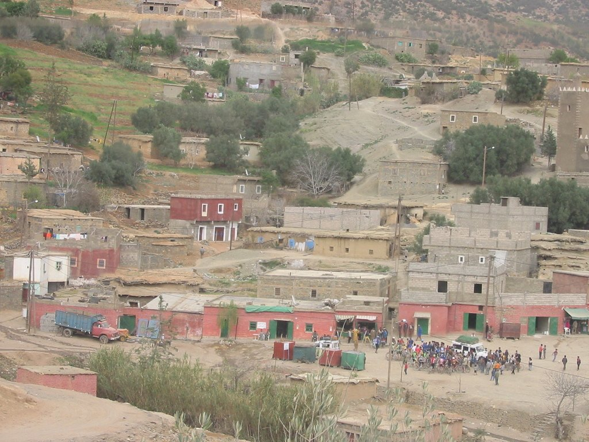
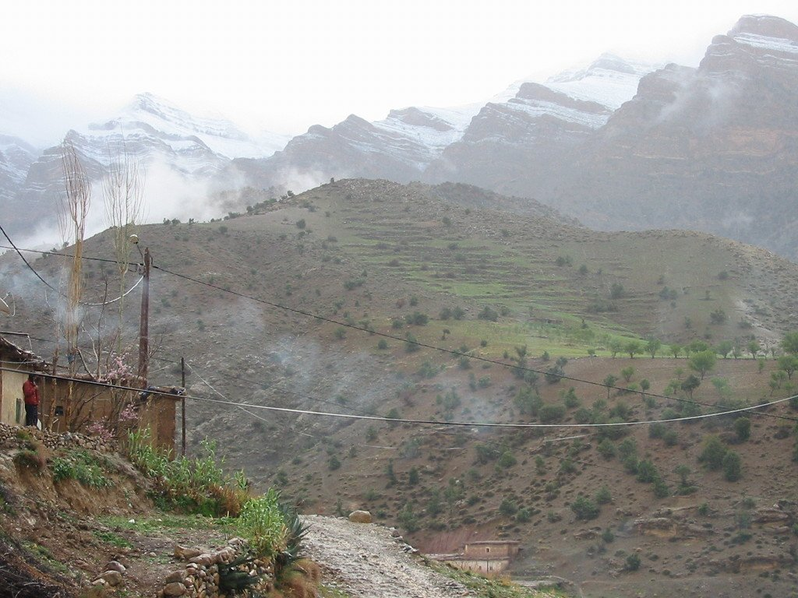
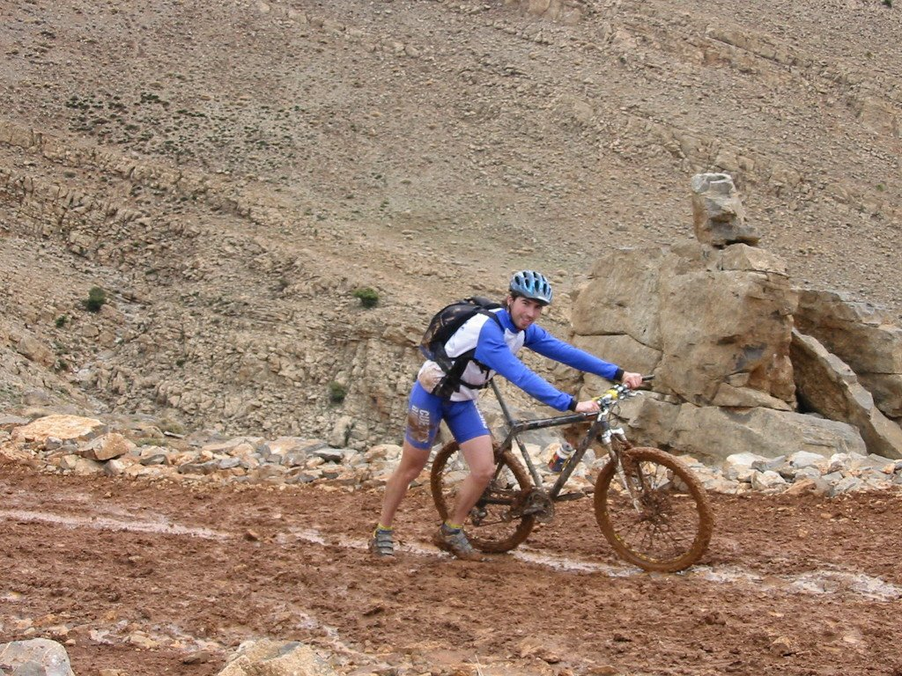
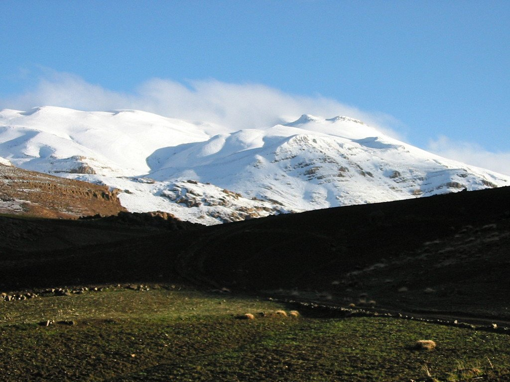
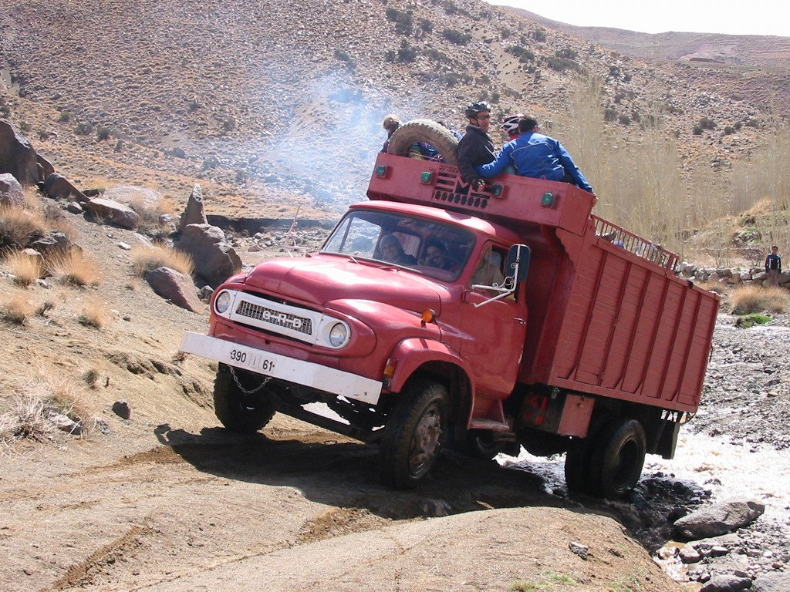
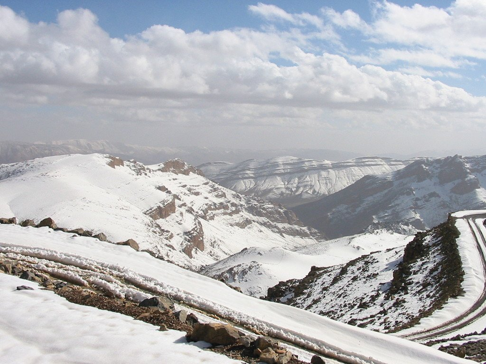
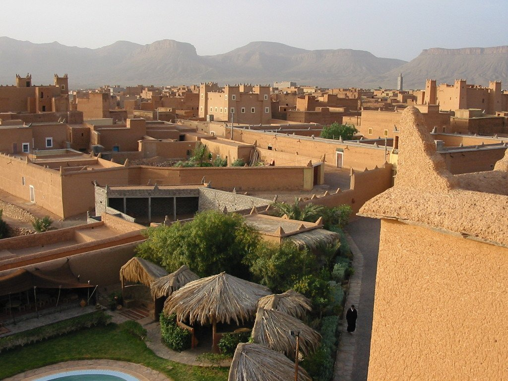
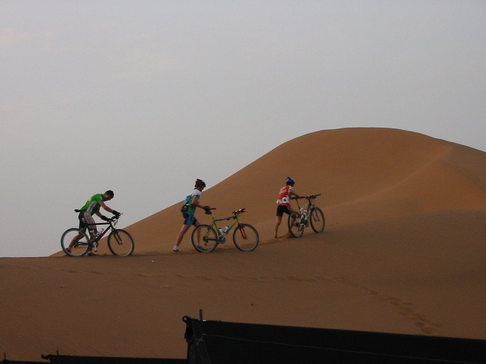

Toda historia tiene un principio, y éste fue el principio de mi afición por los viajes. Por unos y otros motivos no había tenido oportunidad de viajar hasta entonces, o al menos viajar como a mí me apetecía. Todas mis experiencias se reducían a sencillos viajes peninsulares y algunas <em>aventuras</em> como un viaje de estudios en Tenerife. Pero por fin había llegado el momento, iba a realizar mi primer viaje en bicicleta. Y el país elegido, Marruecos.

Desde el primer momento me sentí abrumado por la aventura. Tenía que empaquetar mi bicicleta y facturarla, algo nuevo para mí, y todos los aeropuertos que pisaba se me hacían lugares increíbles. Recuerdo perfectamente el aeropuerto de Casablanca. Todo me emocionaba, desde el control de pasaportes hasta la decoración de las salas de espera para el embarque al vuelo de Marrakech. Realmente es algo que añoro, con el tiempo uno se va acostumbrando y pierde la capacidad de impresionarse. Supongo que el primer viaje, igual que la primera novia, dejan huella.

En Marrakech nos juntamos con el resto de la expedición. Íbamos a madrugar mucho, había unas cuantas horas de todo terreno hasta alcanzar el inicio de la primera etapa. Además las lluvias de los días anteriores habían dejado la zona embarrada y había peligro de desprendimientos. Perfecto para iniciar el viaje.

El largo transfer en todo terreno hasta la salida se convirtió en eterno, y salimos realmente tarde. La etapa discurrió por un cañón, sobre una pista al lado de un río, que nos llevaría hasta un bonito pueblo en las montañas. Pero no había tiempo que perder, era realmente tarde y la noche estaba al caer. Yo no llevaba luces, así que no había más remedio que apretar e intentar llegar de día al final de la etapa. Y así lo hice, finalmente tres ciclistas llegamos antes de que la noche se cerrase por completo. Detrás, mucha gente llegó de noche y muy, muy cansada.

El pueblo donde pasamos la noche tenía un pequeño albergue. Y evidentemente no tenía ducha, sino que en su lugar, tenía un pequeño pero muy confortable hammam. He de reconocer que cuando llegué, lo que me apetecía realmente era una ducha. Pero la experiencia del hammam, la primera para mí, mereció la pena. Era un pequeño cuarto, con paredes de barro, iluminado con la tenue luz de una vela. Dentro, un barreño con agua muy caliente y un grifo de agua helada. Para mezclar a gusto del consumidor. Y cómo no, mucha humedad y mucho calor, casi como una sauna. Me equivocaba, me apetecía una ducha porque no conocía de la existencia de un baño tan relajante.

La noche fue fría, y no paró de llover ni un solo momento. Al día siguiente teníamos que cruzar un puerto de más de 2.000 metros de altura, y la climatología nos preocupaba. A la mañana siguiente, la cosa pintaba fea. El camino de ascenso estaba embarrado y, aunque no hacía mucho frío, era probable que en lo alto de la montaña la cosa se pusiese peor.

Comenzamos la subida por una pista embarrada, y era un tipo de barro arcilloso que no dejaba avanzar la bicicleta. Era tan pegajoso que ni empujando podíamos subir nuestras bicicletas, y la única opción era echarlas al hombro y caminar. Mucho, demasiado. La ascensión se hizo eterna.

Pero lo peor estaba por llegar. En lo alto de la montaña la temperatura se desplomó, el viento soplaba con fuerza, la lluvia se volvió nieve y el terreno seguía impracticable. La bicicleta dejó de ser un medio de transporte para convertirse en un estorbo, y mucha gente optó por abandonarla en la pista para poder avanzar más rápido y buscar un lugar donde cobijarse. Después de un buen rato de pelear con el barro, llegamos a una cabaña de unos pastores. No era una vivienda, sino una de esas cabañas donde guardan el ganado. Estaba llena de paja y parecía confortable, al menos los muros nos protegerían del viento. Los pastores nos invitaron a entrar, lo cual agradecimos enormemente. La paja nos sirvió de manta, para quitarnos el frío, y de toalla para sacarnos la humedad. Nos dieron la vida. Después de un buen rato, el tiempo cambió. El viento paró, el cielo se abrió y salió el sol. La calma tras la tempestad.

Ya se había hecho muy tarde y llegar al destino planeado se hacía imposible, por lo que decidimos buscar un lugar alternativo para pasar la noche. Y como suele pasar en estas ocasiones, las situaciones improvisadas son las más interesantes. Para mí era la primera vez en un país árabe, e iba a experimentar por primera vez su hospitalidad. Mientras bajábamos de la montaña, nuevamente empujando la bici entre el barro, desde una cabaña nos invitaron a pasar. No nos lo pensamos y entramos. Era una pequeña cabaña, con dos estancias y una estufa. La mujer nos preparó un té de hierbabuena, con mucho azúcar. Suponemos que era un azúcar sin tratar, menos dulce que el que consumimos habitualmente, porque no estaba tan dulce como cabría esperar tras ver cómo echaba dos enormes piedras en el té. Eran un matrimonio de campesinos, con un hijo, y poco que ofrecer. Pero nos lo ofrecieron todo. Ese té caliente al lado de la chimenea fue un lujo tras un día tan duro. Esa familia me enseñó muchas cosas y, lo más importante, me quitó prejuicios. Ese día dejé de comportarme como un ciclista y comencé a comportarme como un viajero. O al menos eso quiero creer.

Seguimos descendiendo la montaña y llegamos a un pueblo más grande, muy bonito, y encontramos un sitio para dormir. Aunque el día amaneció soleado, la crecida del río no recomendaba pedalear, así que buscamos un medio de transporte alternativo. La suerte estaba de nuestro lado y <em>el camión del pueblo</em> estaba disponible. Pues nada, al camión.

Avanzamos en camión unos kilómetros, hasta que salimos del cauce del río. Cuando la cosa mejoró volvimos a subirnos a la bici, y tuvimos finalmente una bonita etapa. Un poco larga, ya que hubo que hacer lo que nos quedaba de la etapa del día anterior sumado a la etapa de hoy. A última hora llegamos a Imilchil, un pueblo con un bonito lago, un hotel y un hammam. ¿Qué más se puede pedir? El hotel era confortable aunque muy frío y las habitaciones estaban bien surtidas de mantas, aunque había que echarle narices para quitarse la ropa y meterse en la cama.

El día volvió a amanecer frío. No contaba con este clima en Marruecos. Además teníamos que cruzar el Atlas, por un puerto que según nos decían estaba bastante nevado, y no nos mentían. La subida fue tremenda, muy larga y con mucha nieve. Por fortuna las rodadas de los todoterreno que habían pasado antes nos permitieron atravesar el puerto sin problemas.

Este día llegábamos a la garganta del Todra, y tenía muchas ganas de atravesarla en bicicleta. Por desgracia, una avería me obligó a ir en el camión escoba, y pasé por esa zona ya bien entrada la noche. Habrá que volver otra vez para verlo con más calma.

Esa noche dormimos en un pueblo sin ningún interés, se nota que estábamos en una zona turística. Pero aún quedaban dos bonitas etapas, ahora por zonas más desérticas. Al día siguiente nos adentramos en pistas rocosas, camino de Zagora, acercándonos al desierto por un paisaje que era cada vez más bonito. El viento soplaba con fuerza y la etapa se hizo dura, atravesamos varios pueblos hasta Nkob, lugar donde hicimos noche en unas bonitas y confortables jaimas. Ya solo quedaba una etapa, estábamos muy cerca del final y de alcanzar, por fin, el bonito desierto del Sáhara.

La última etapa se hizo pesada. Un fuerte viento en contra nos acompañó durante toda la etapa por las duras pistas pedregosas. El paisaje era cada vez más árido y rocoso. Poco a poco nos fuimos acercando a Zagora, la puerta del Sáhara, las dunas y la arena nos esperaban aunque solo fuese de manera testimonial para darnos la bienvenida. Mi primer desierto ya era historia. El viaje había merecido la pena. Algo había cambiado en mi interior, había perdido prejuicios y ganado sabiduría. Había encontrado mi camino.

