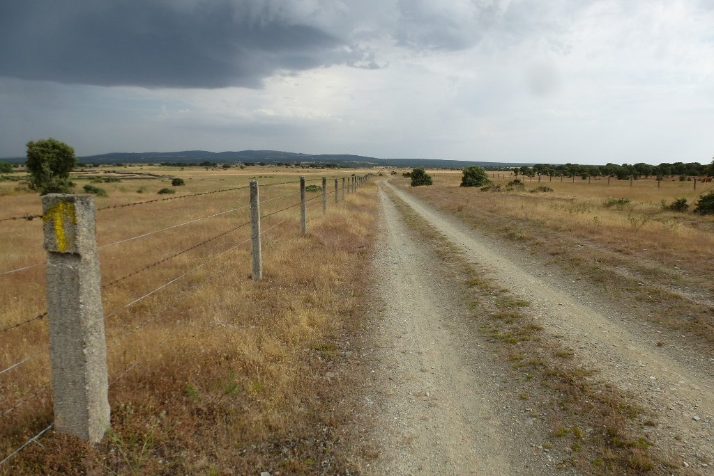
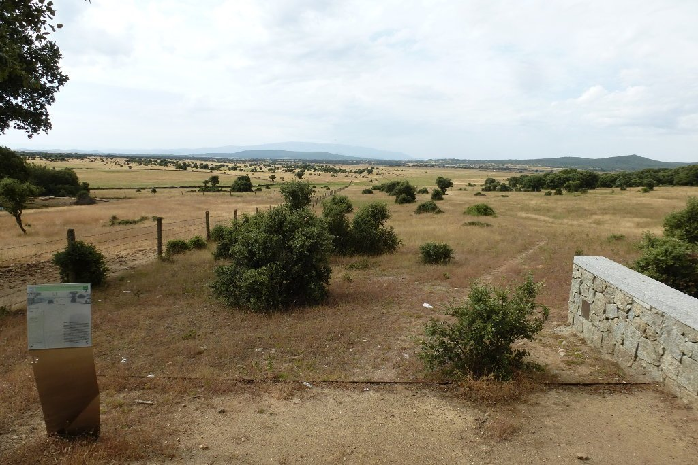
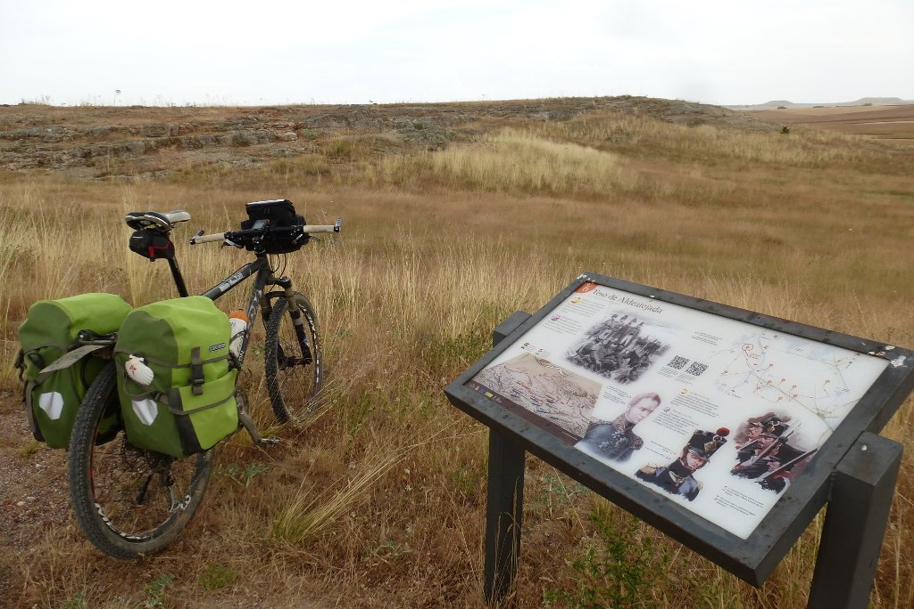

Siguiendo con esta última serie de rutas del tipo <em>saliendo desde mi casa llegar a nosedonde</em>, o bien <em>llegar a mi casa saliendo desde otro sitio</em>, se me ocurrió realizar la Ruta de la Plata. Cruzar la península de sur a norte se me antojaba interesante y, aunque por número de días libres no podría salir desde Sevilla, tal vez podría realizar un trayecto más corto y dejar el sur para otra ocasión. Un recurso muy interesante para preparar esta ruta es la web <a href="https://rutadelaplata.com/">Ruta Vía de la Plata</a>. La información proporcionada en esta página, con recursos tanto para ciclistas como para caminantes, me ayudó a decidirme sobre el trayecto a realizar. Saliendo desde Béjar, poco más de 500 kilómetros me separaban de mi casa. Béjar, ¡allá vamos!

La primera etapa, aunque parezca mentira, empieza en Oviedo. Eso sí, en coche, y muy muy temprano. Nos lanzamos a la carretera de madrugada con intención de llegar a Béjar para estar pedaleando a las nueve de la mañana. Cumplimos el plan y me dejan en la calzada de Béjar a las nueve en punto.

Rumbo norte y sin prisa avanzo por unos caminos con buen firme y prácticamente sin curvas. Con mucha fortuna voy esquivando la tormenta, o la tormenta me esquiva a mí, no lo tengo claro. Lo que sí es evidente es que nos hemos tanteado mucho, paso por caminos muy mojados y veo las nubes y los relámpagos no muy lejos. El camino no parece muy transitado. Por un lado, no me encuentro con ningún peregrino durante toda la mañana, y por otro, veo que los caminos requieren un mantenimiento que no se ha realizado en mucho tiempo. Hay determinadas zonas en las que tengo que abandonar el camino y tomar la carretera tras una cómica escena en la que desaparezco literalmente entre una vegetación más alta que yo. No obstante, la calzada de Béjar se adueña del paisaje. Es ancha y con buen firme, y el paisaje es muy bonito.

Los caminos no son muy complicados y avanzo rápido. Dado que el final de etapa es en Salamanca, el plan es llegar temprano para poder visitar la ciudad. Pero antes hay que subir al Pico de Dueñas, de 1.140 metros de altura. Un bonito sendero, totalmente ciclable, asciende bruscamente hasta el pico.

El silencio sólo se rompe por el sonido de la planta eólica situada en su cumbre, y justo antes de llegar me encuentro con los dos únicos peregrinos del día.

Desde aquí, un bonito descenso y unos caminos muy favorables me llevan rápido hasta <em>San Pedro de Rozados</em>, donde hago un pequeño alto en el camino. Acostumbrado a los pueblos del norte me sigue llamando mucho la atención lo difícil que puede resultar encontrar un bar en un pueblo. Finalmente doy con él y aprovecho para comer algo y, de paso, sellar mi cartilla de peregrino. Aunque mi intención no es ir a Santiago, sí que aprovecho para sellarla y actuar como si fuese un peregrino más.

Pocos kilómetros me separan ya de Salamanca. El paisaje cambia y atravieso grandes tramos de dehesa. Cerca de Salamanca, en Aldeatejada, me detengo a contemplar los lugares donde el duque de Wellington obtuvo la victoria sobre las tropas francesas en la Batalla de los Arapiles.

A mi espalda, Salamanca. Tras unos pocos kilómetros más cruzo el puente de entrada a tan bella ciudad. 70 kilómetros, primera etapa completada.
