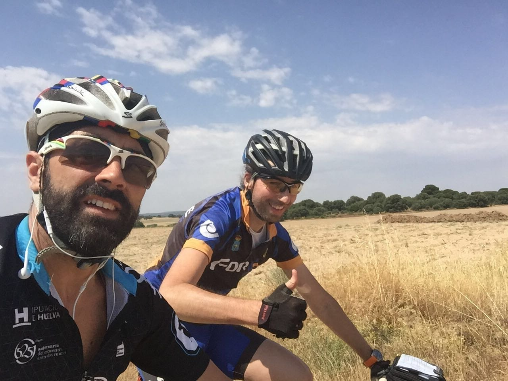
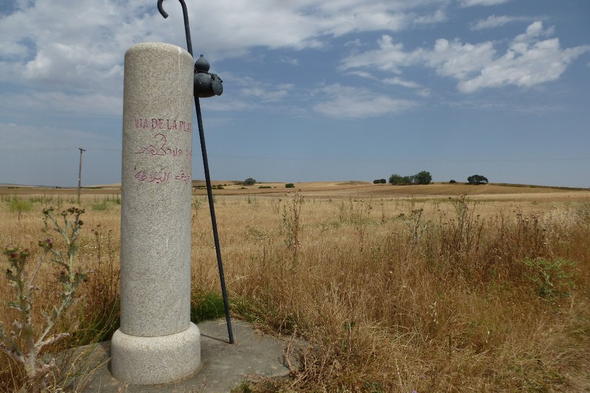
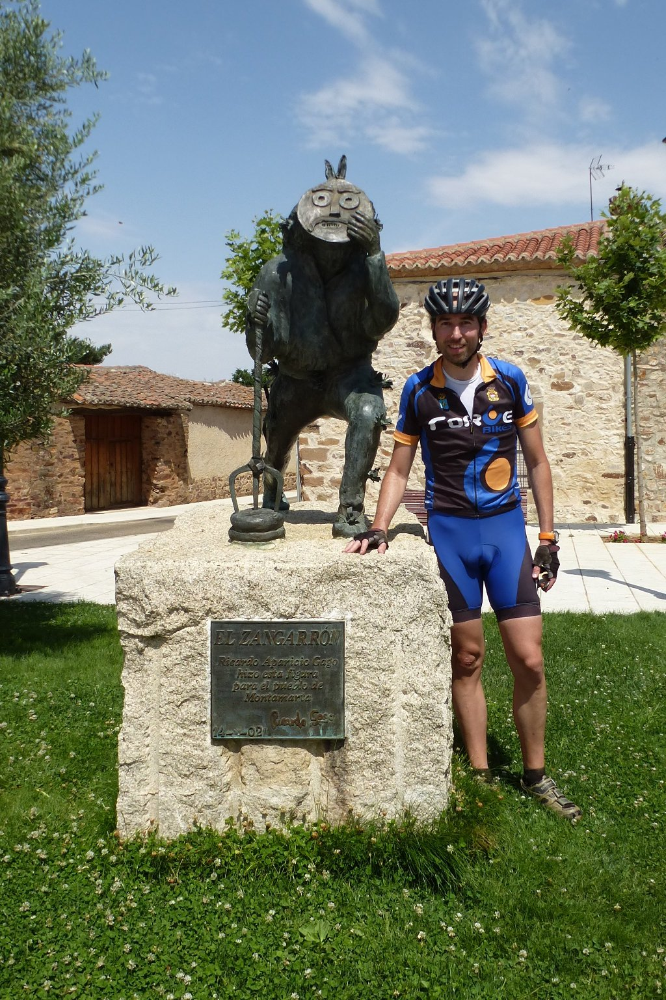

La etapa de hoy no parece muy interesante. Más de cien kilómetros absolutamente llanos me separan de Granja de Moreruela, destino programado para la etapa del día. Antes de salir de Salamanca me encuentro con David, un sevillano muy simpático. Viene haciendo la Ruta de la Plata desde Sevilla, con intención de llegar a Granja de Moreruela para ahí desviarse y tomar el camino sanabrés con rumbo a Santiago de Compostela. Dado que tenemos el mismo destino para el día de hoy, decidimos compartir ruta.

La ruta no es muy interesante. Una sucesión de caminos con buen firme nos hacen avanzar rápido y, aunque no salvamos ningún desnivel, el nuevo trazado como vía de servicio de la autopista A-66 es más duro de lo que parece. Vamos paralelos a dicha autopista en una sucesión de tunel - puente - tunel... que se hace interminable. De un tunel que pasa bajo la autopista subimos hacia un puente que pasa sobre ella, para bajar a otro tunel y subir nuevamente a otro puente... mientras que la autopista discurre totalmente llana. Un completo absurdo. No obstante, nos queda el alivio de pensar en qué sería de nosotros si fuésemos caminando. O peor, si fuésemos solos.

Charlando tranquilamente llegamos casi sin darnos cuenta a Zamora, justo a la hora de comer. Tras una pequeña vuelta por la ciudad nos paramos en la plaza mayor a comer algo. Y ese <em>algo</em> se transforma en un menú de dos platos que nos da sueño y nos quita ganas de dar pedales. Pero aún quedan kilómetros, así que no nos podemos dormir.

El calor aprieta. Las enormes rectas se hacen interminables en bici, y cuando adelantamos a algún caminante pensamos en lo dura que tiene que ser esta parte a tan poca velocidad. Algunas rectas deben durar horas. Una de estas rectas interminables nos lleva a Montamarta, un pequeño pueblo donde paramos a beber algo frío y descansar un poco.

Tras pasar Montamarta, el nuevo trazado y el escaso mantenimiento del camino nos juega una mala pasada. Las indicaciones del camino nos llevan por un trazado que ya no existe, el GPS nos indica el mismo camino y tenemos que buscarnos la vida. Tras empujar un poco la bici y aprovecharnos del bajo nivel del embalse, salvamos la dificultad y volvemos al camino. Una sucesión de larguísimas rectas, interrumpidas únicamente con alguna parada y algún refresco, nos llevó hasta Granja de Moreruela, fin de etapa del día de hoy. Una buena cena y el cómodo (y descuidado) albergue municipal era lo que nos quedaba para disfrutar del día.
