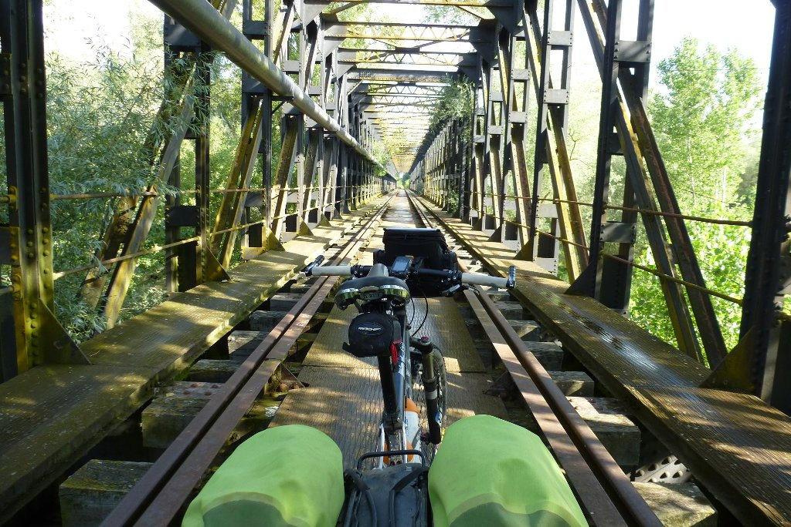
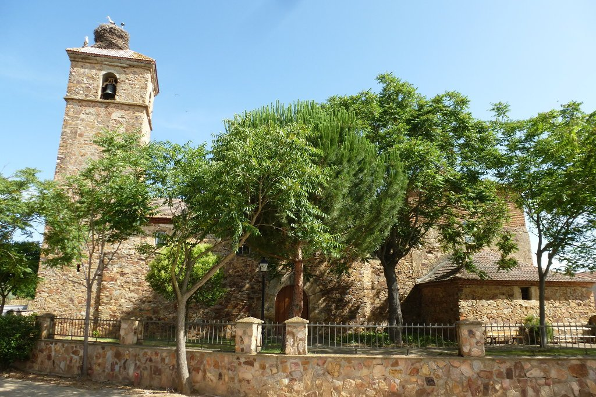

Hoy retomo la ruta en solitario. David, mi compañero de ruta en el día de ayer, se desvía hacia el oeste dirección Puebla de Sanabria, mientras que yo sigo rumbo norte hacia Hospital de Órbigo. Largas y llanas rectas entre los terrenos de cultivo me acompañarán durante las horas de la mañana. Por fortuna una suave y fresca brisa ayuda a llevar el pedaleo con comodidad. La monotonía de la ruta es rota de golpe por uno de esos lugares con encanto que te arrancan una sonrisa y te obligan a disparar unas cuantas fotos para tratar de inmortalizarlo. Es una pena no ser un buen fotógrafo.

El antiguo puente del ferrocarril sobre el río, ya en desuso, es utilizado hoy en día por los peregrinos que van de camino a Benavente. Eso sí, circular sobre él con la bici cargada es bastante peligroso, hay que hacerlo con mucho cuidado.

Pocos kilómetros más adelante el camino pasa por Benavente, donde aprovecho para descansar un rato. La ruta continúa por caminos y carreteras secundarias, atravesando grandes campos ya mucho más verdes que en la provincia de Zamora. Sin grandes cambios en el paisaje llego a La Bañeza, donde aprovecho para darle una vuelta al famoso circuito de motos y hacer una parada para comer. 

Sin mucho más que destacar, llego a Hospital de Órbigo y me uno al Camino Francés. Es impresionante ver la cantidad de gente que mueve este camino, he viajado prácticamente solo desde Béjar hasta aquí y, al llegar a Hospital de Órbigo, me encuentro con un pueblo abarrotado de caminantes. No es que me moleste la compañía, pero lo del Camino Francés en verano es demasiado, en mi opinión. Sólo me queda hacerlo a la contra hasta León para abandonarlo justo ahí dirección a Oviedo, por el camino del Salvador.
