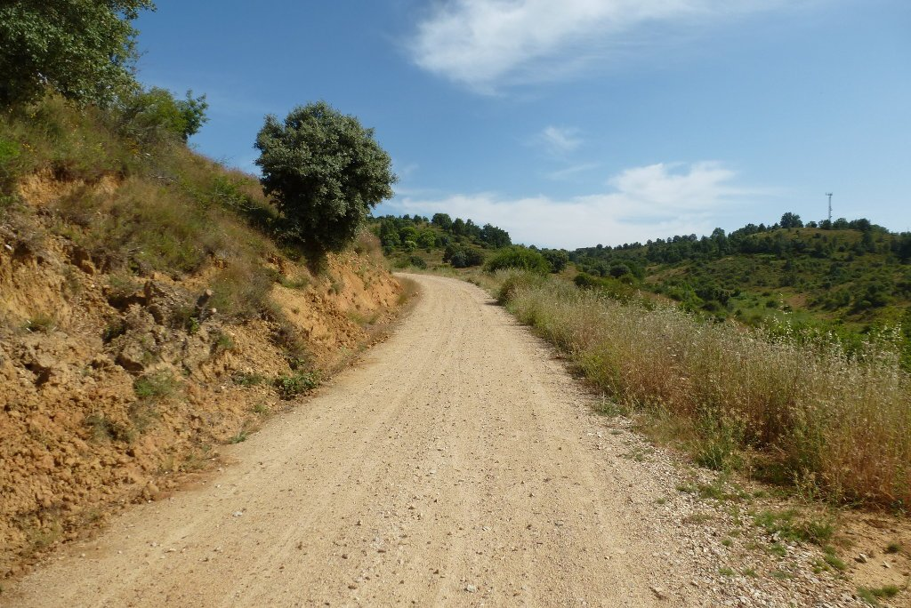

Siete de la mañana. Lo que la noche anterior era un albergue abarrotado de gente se ha convertido en un lugar vacío. Sólo quedo yo. El Camino Francés me sigue impresionando, por fortuna hoy cambio al Camino de San Salvador.

Esta soledad durará poco. Me lanzo a pedalear a la contra del Camino Francés hasta León, y me encuentro con una marea de gente que lo inunda todo. Es tal el volumen de gente que me veo obligado a abandonar el camino y circular por la carretera, no hay espacio para cruzarse con los abundantes grupos de caminantes. Por fortuna, poco más de 30 kilómetros me separan de León, a donde llego en poco más de una hora. Hago una pequeña parada y cojo rumbo norte, ya en el Camino de San Salvador. Vuelvo a estar solo, otra vez.

El camino es un continuo sube-baja de pistas al principio y senderos después, muy divertidos. Atravieso una serie de pueblos que conozco de nombre pero que nunca había visitado, zonas muy bonitas que me recuerdan que Zamora ha quedado atrás y ya miramos a Asturias.

Esta parte de la ruta la estoy disfrutando especialmente, tanto que me paso Pola de Gordón, el lugar donde pensaba comer... y acabo dando la vuelta. Es curioso cómo cambia el terreno según el punto de vista. Habré pasado por aquí, en coche, cientos de veces, y nunca había visto los pueblos que estoy atravesando hoy.

Finalmente llego a Poladura de la Tercia. Un modesto, aunque cómodo, albergue municipal me espera. Y está lleno de caminantes, lo cual me sorprende bastante dado que no he adelantado a nadie en ruta. Apenas hay sitio para todos, y no todos traen comida. Una pareja de italianos acaba cogiendo un taxi hasta Villamanín para comprar comida, porque en Poladura no hay ni bar ni restaurante.

Rápidamente hacemos buenas migas y nos pasamos lo que queda de tarde charlando. Hay gente de Euskadi, Alemania, Italia... y yo, llegando a casa. Aprovecho para revisar la bici, no quiero sustos de última hora. Mañana es la última estapa del Camino de San Salvador, mañana llego a casa.
