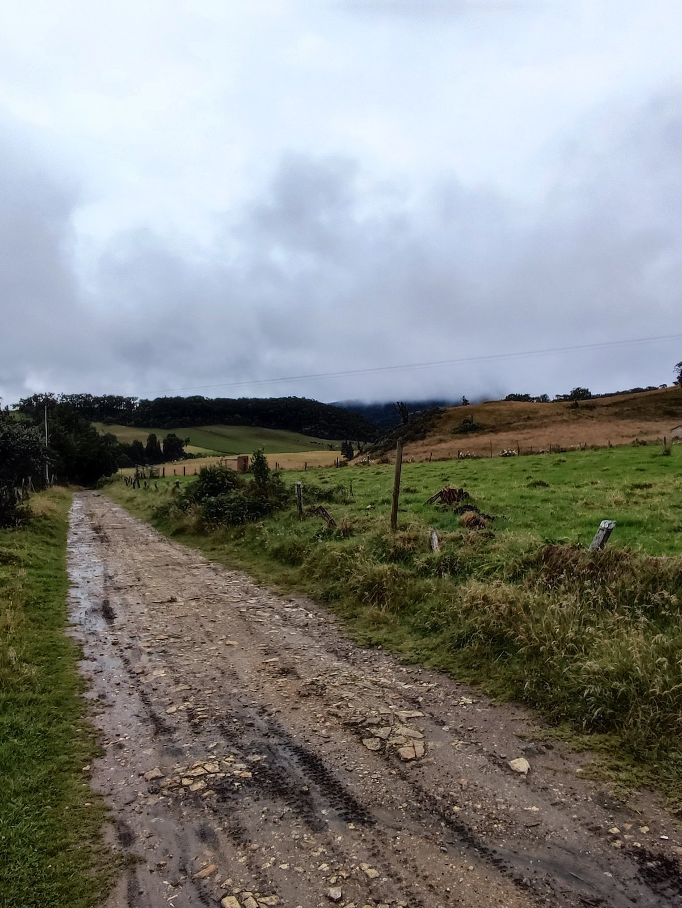
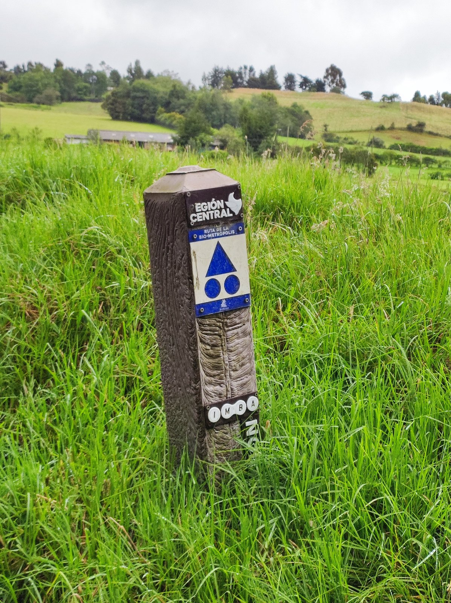
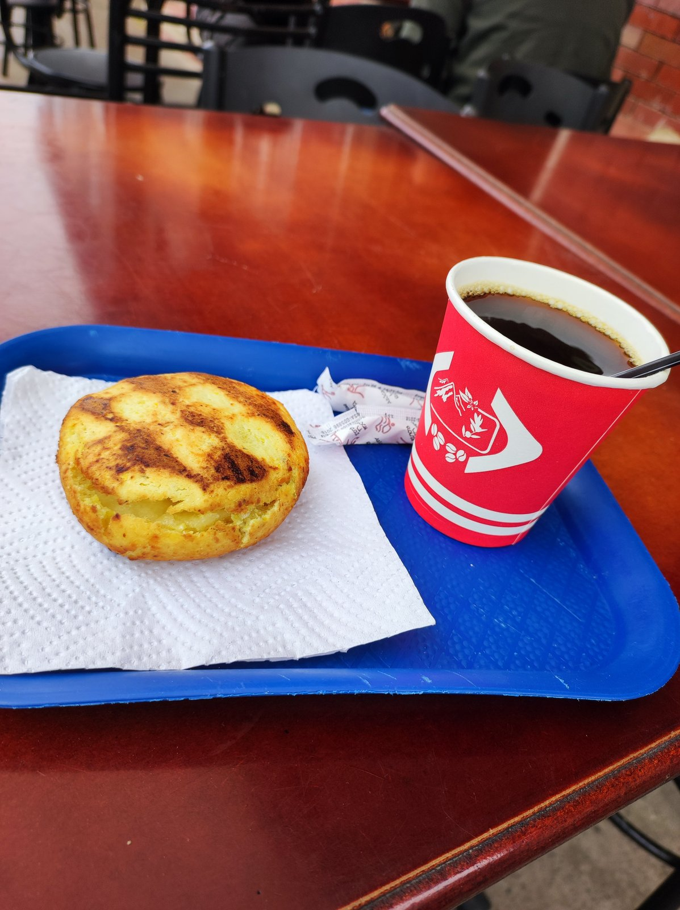
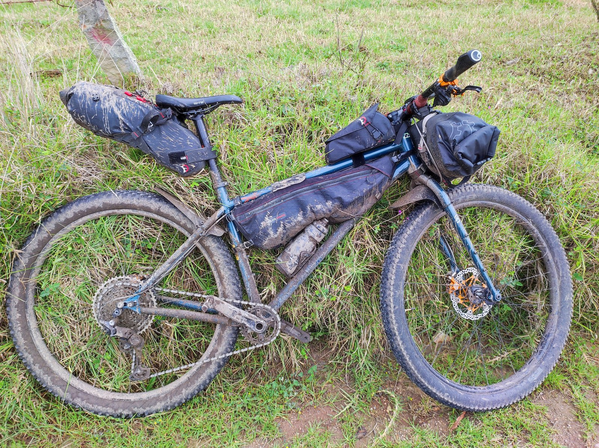
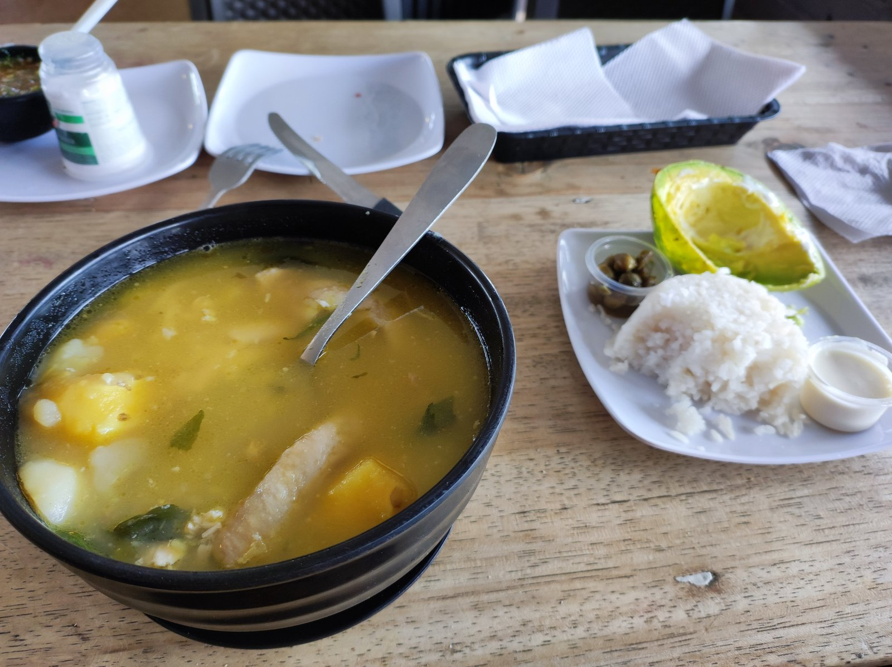
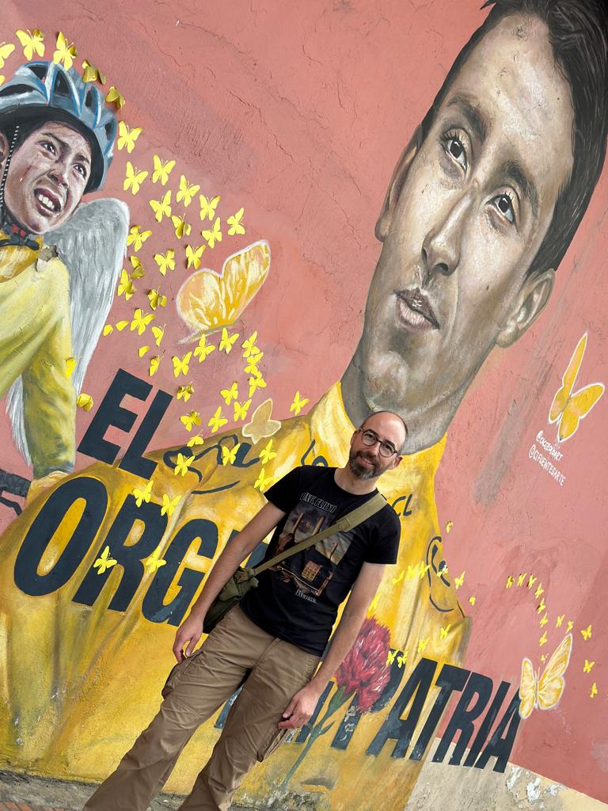
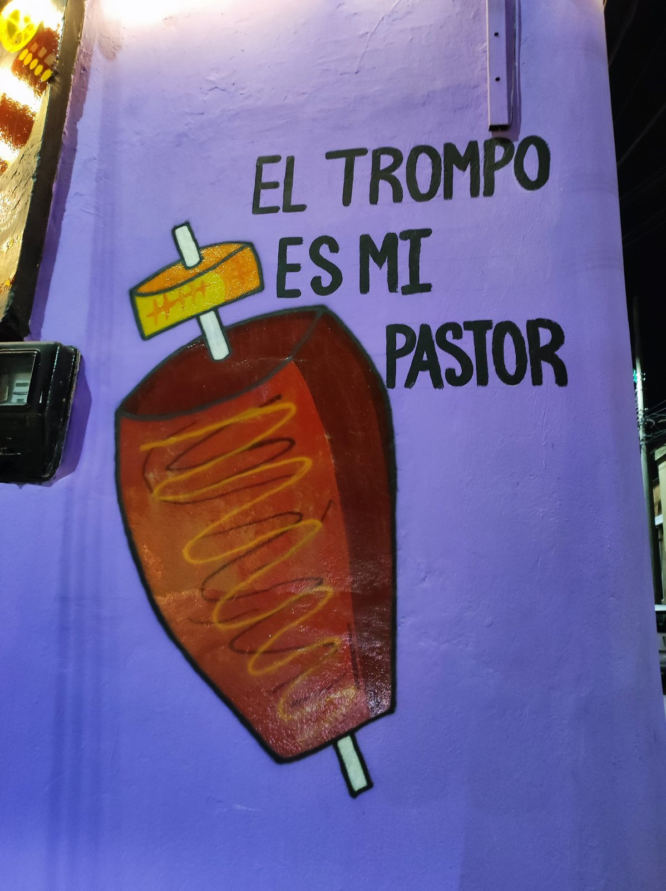
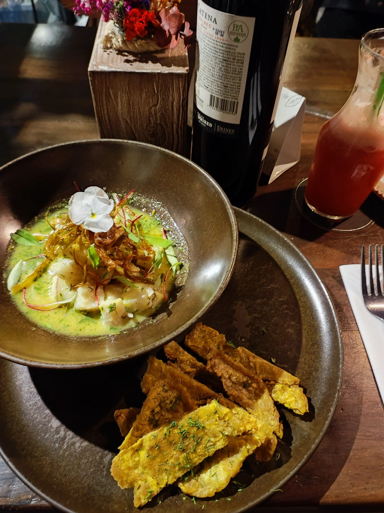

Ya había tenido mi primera toma de contacto con Colombia el fin de semana anterior, cuando hice una pequeña excursión saliendo de Bogotá y subiendo la mítica subida de Patios. Este también iba a ser el comienzo de la ruta de hoy.

Salí por Patios bien temprano. Pero no importa lo temprano que vayas: un sábado en Patios significa tráfico. Pero no tráfico de coches, sino tráfico de ciclistas. Es difícil de describir, porque creo que solo había pedaleado rodeado de tantos ciclistas en carreras. Pero esto no era una carrera. Y había ciclistas, ciclistas y más ciclistas. La experiencia es maravillosa.

Una vez en la cima de Patios, me desvié por un camino que me alejó de todo ese tráfico de ciclistas. Bogotá se encuentra bastante alto, a 2.600 metros sobre el nivel del mar, y esta subida te lleva aún más alto, con lo cual es fácil meterse en la niebla. Al poco de coronar, me metí en la niebla y en una lluvia fina que ya no me abandonaría durante todo el día.

Siguiendo una ruta que está cuidadosamente marcada, me fui alejando de Bogotá hasta llegar a La Calera.

Aunque llevaba poca ruta, ya apetecía tomar algo caliente. Y aquí es donde empecé a disfrutar de la amabilidad colombiana. Nada más pasar por delante de un bar, ya me ofrecieron un café con cualquier otra cosa que se me antojase. Como aún no llevaba muchos kilómetros, lo acompañé de una pequeña arepa.

A partir de ahí he de reconocer que apenas tomé fotos. La lluvia se hizo más intensa, el camino se fue embarrando y el frío se me metió en el cuerpo. Así que solo quería llegar.

Cuando ya iba apretando el hambre, a mi paso por Briceño, vi un restaurante en el que había bastantes bicicletas. Supuse que sería como dice el dicho: donde paran los camioneros, se come bien. Y vaya si acerté. Un magnífico <em>ajiaco santafereño</em>. Grande, muy grande, tal vez demasiado para continuar dando pedales.

Por fortuna ya quedaba poco hasta Zipaquirá, el fin de la ruta de hoy. Solo quedaba un pequeño manguerazo para dejar la bicicleta limpia y lista para mañana.

Y sí, ahí estaba, en Zipaquirá, lugar de origen del gran ciclista Egan Bernal.

Ya solo quedaba ir al alojamiento, buscar un lugar donde cenar y acostarse temprano para la siguiente etapa.

Fue una grata sorpresa encontrar un restaurante como El Labriego, donde nuevamente volví a disfrutar de la gastronomía colombiana. Dos días más y estaría de vuelta en Bogotá.

