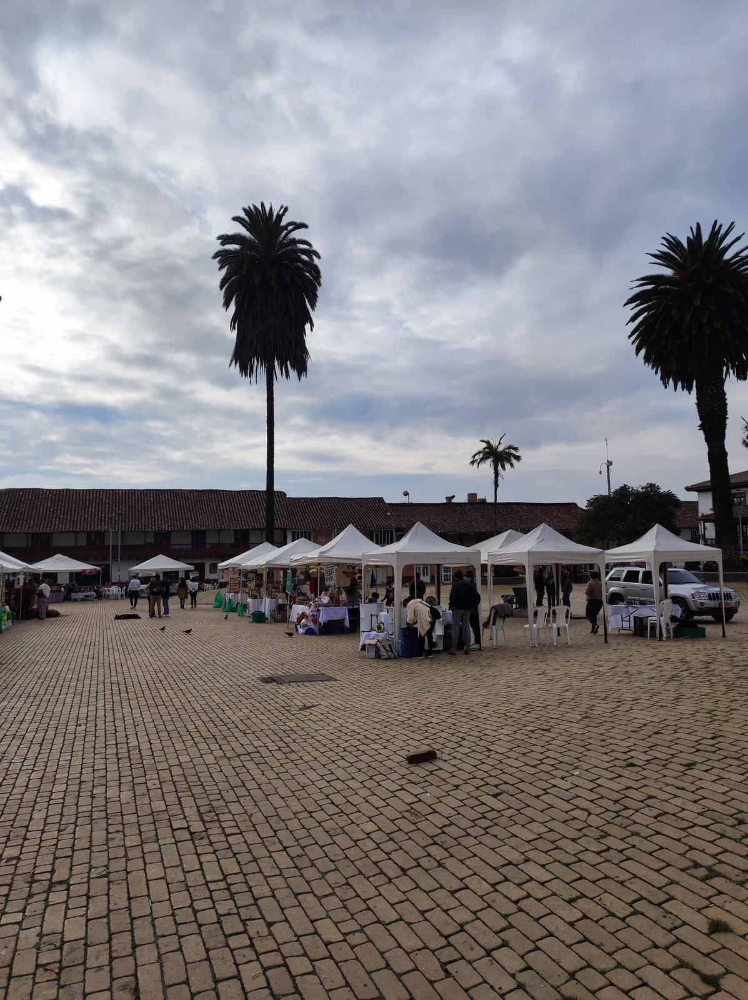
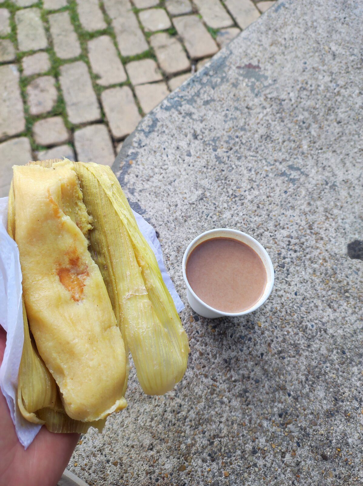
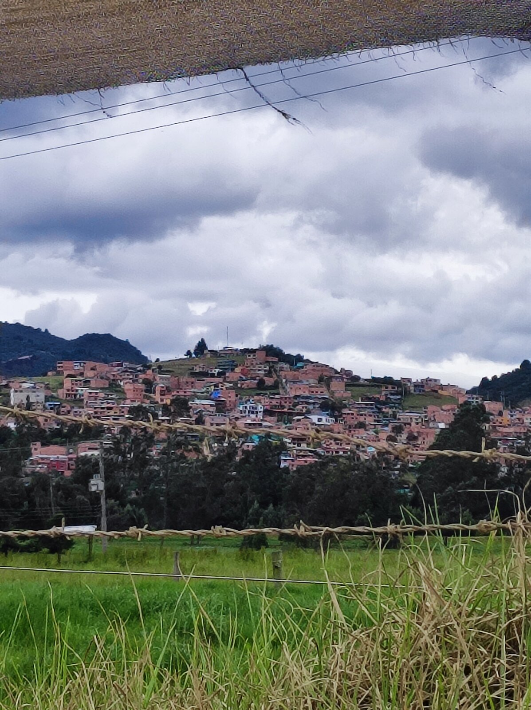
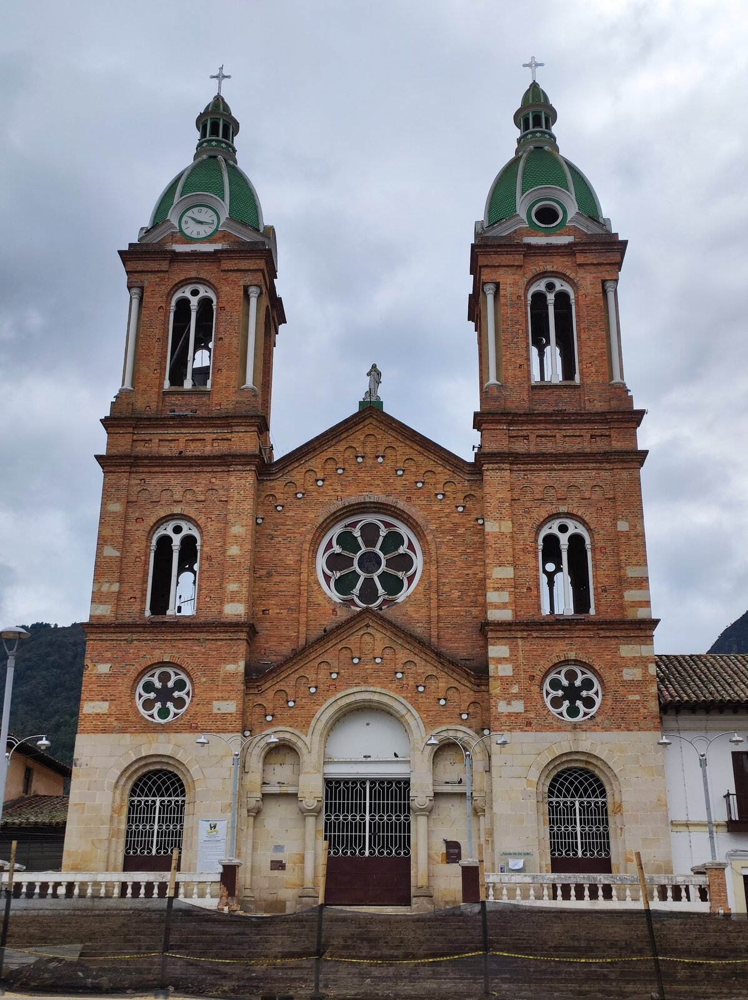
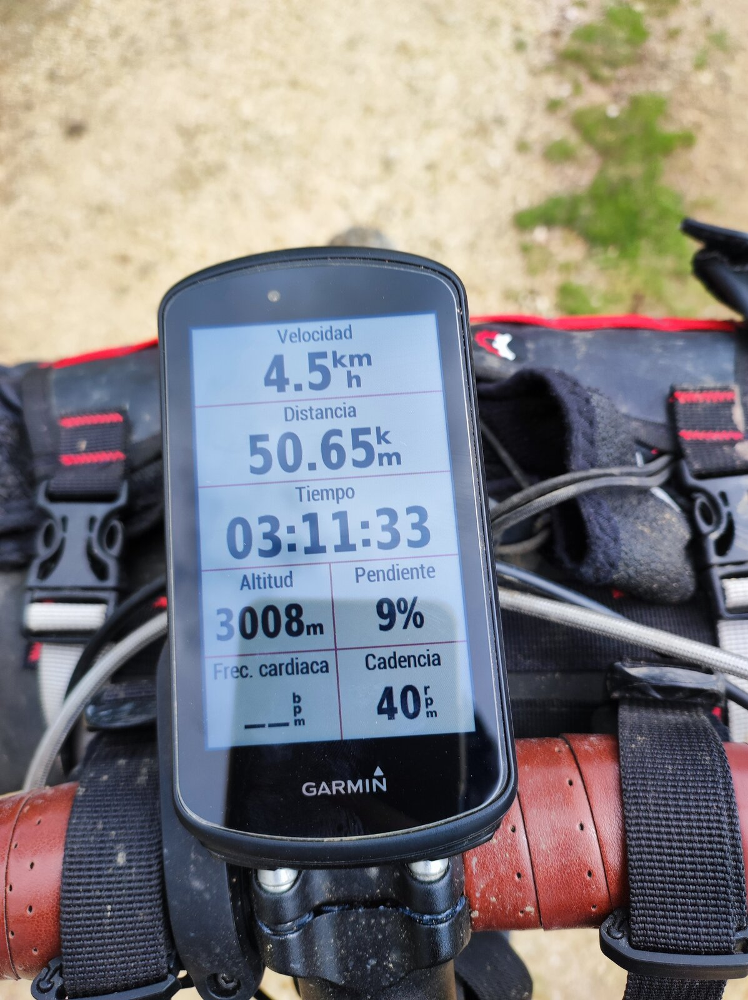
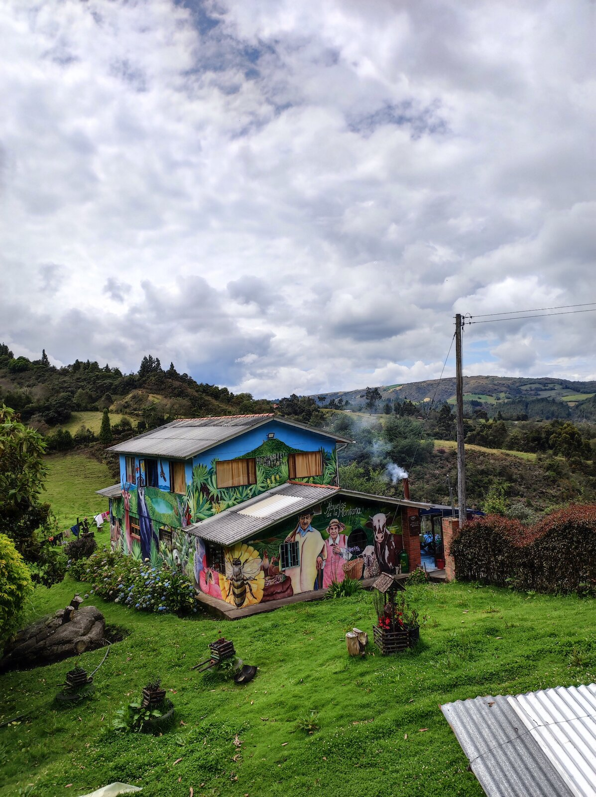
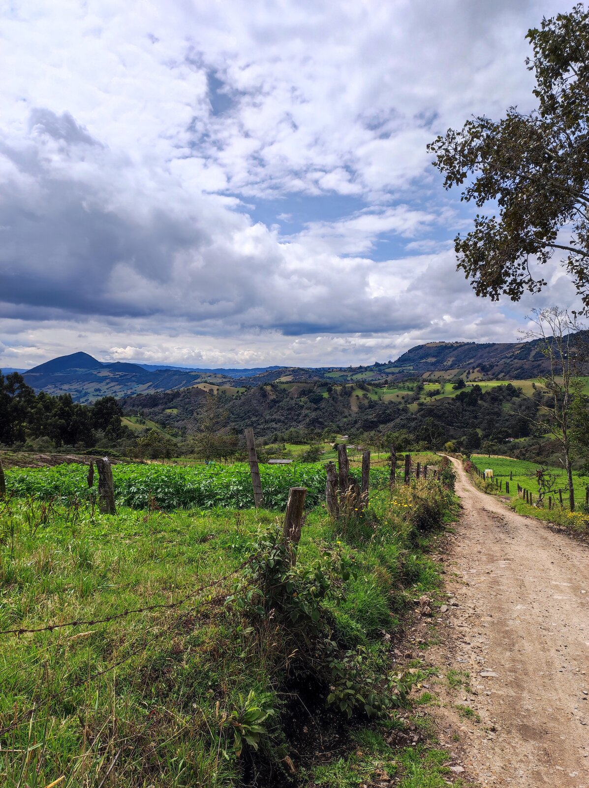
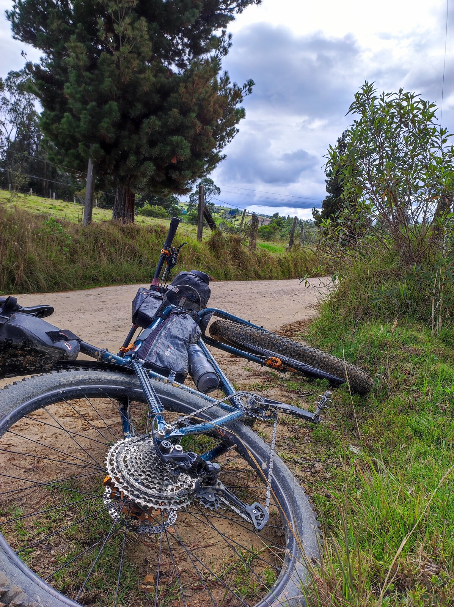
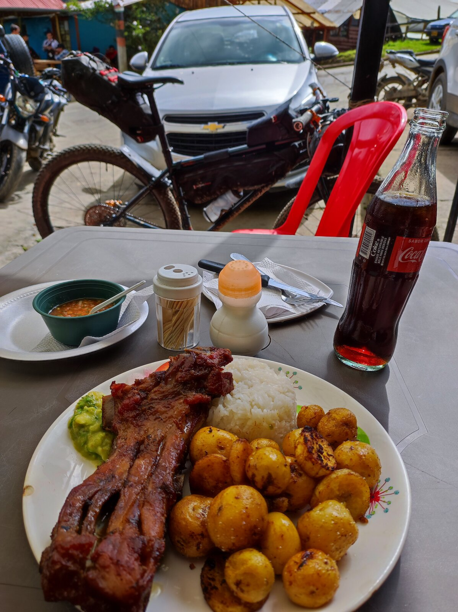

Lo primero que hice al día siguiente fue buscar un lugar para desayunar. Me dirigí al bar que había mirado en internet, pero estaba cerrado. Afortunadamente, en la plaza de Zipaquirá me encontré con un mercado, así que pude dar un paseo, ver las artesanías locales y, cómo no, desayunar.

Un <em>envuelto de choclo</em>, o dos, y un chocolate fueron suficientes para darme energía para el resto de la mañana.

El camino desde Zipaquirá hasta Guasca fue toda una tortura. No había ni un metro llano: todo era subir o bajar.

Lo cierto es que no hubo nada reseñable durante este día, salvo el principio y el final.

En una de estas subidas alcancé el techo de la ruta: 3.000 metros.

Eso sí, el paisaje fue muy bonito.

Y se nota. Cuando los kilómetros pasan rápido es que realmente lo estás pasando bien.

En Guatavita, justo antes de llegar a Guasca, hice la parada para comer. Comer... es algo que recuerdo mucho de este viaje.

Ya en destino, me alojé en una pequeña casa de invitados, donde disfruté de la tranquilidad de las montañas colombianas.
