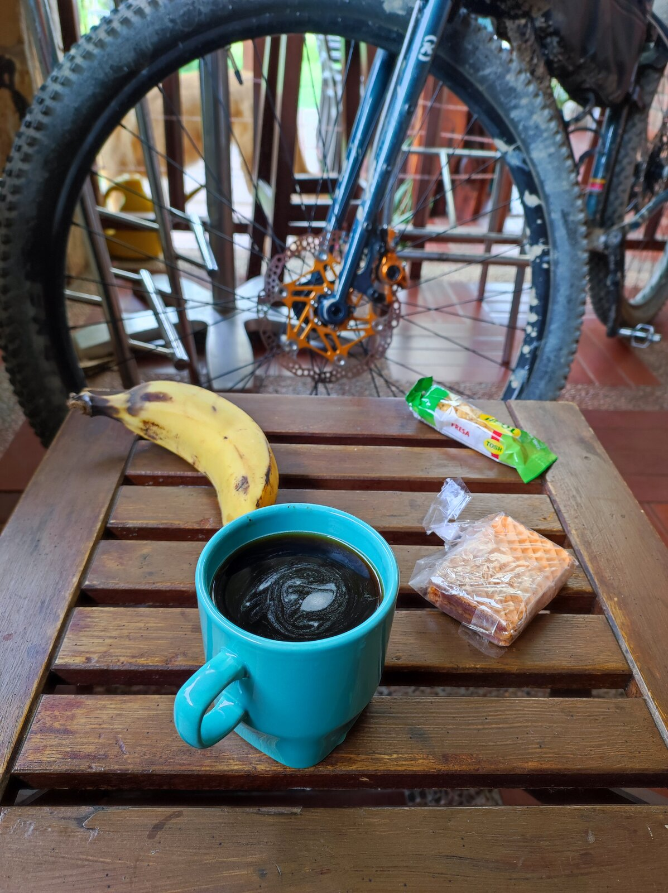
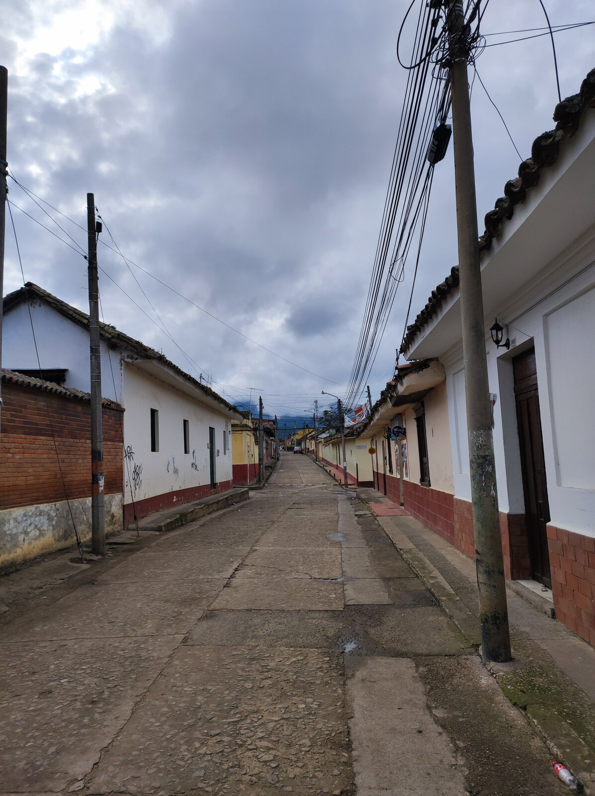
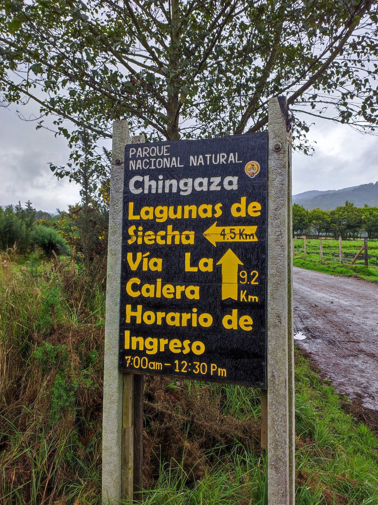
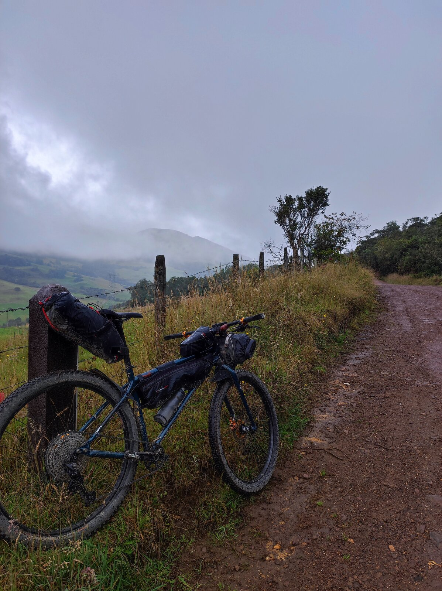
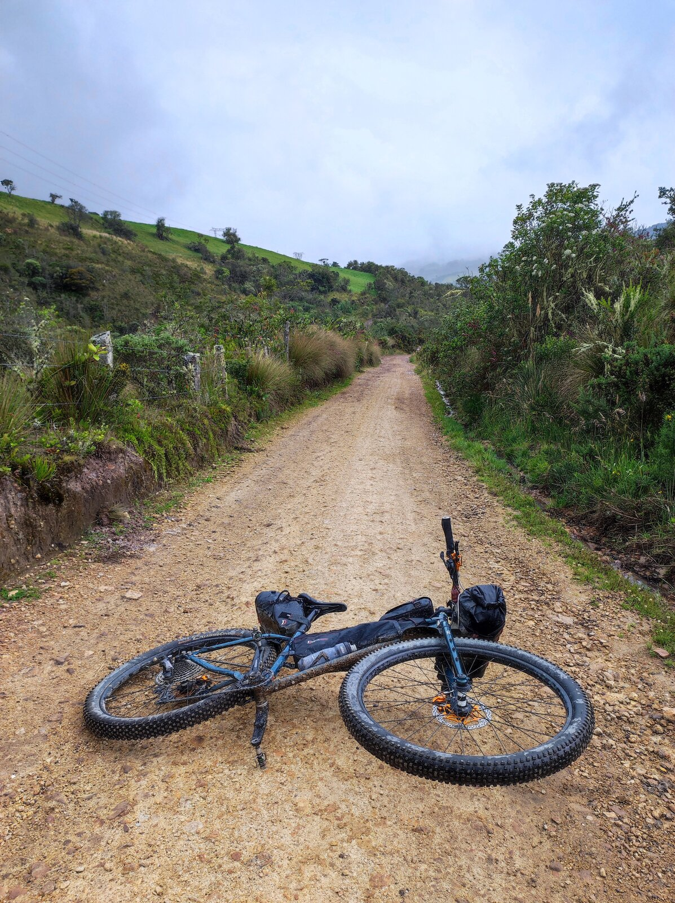
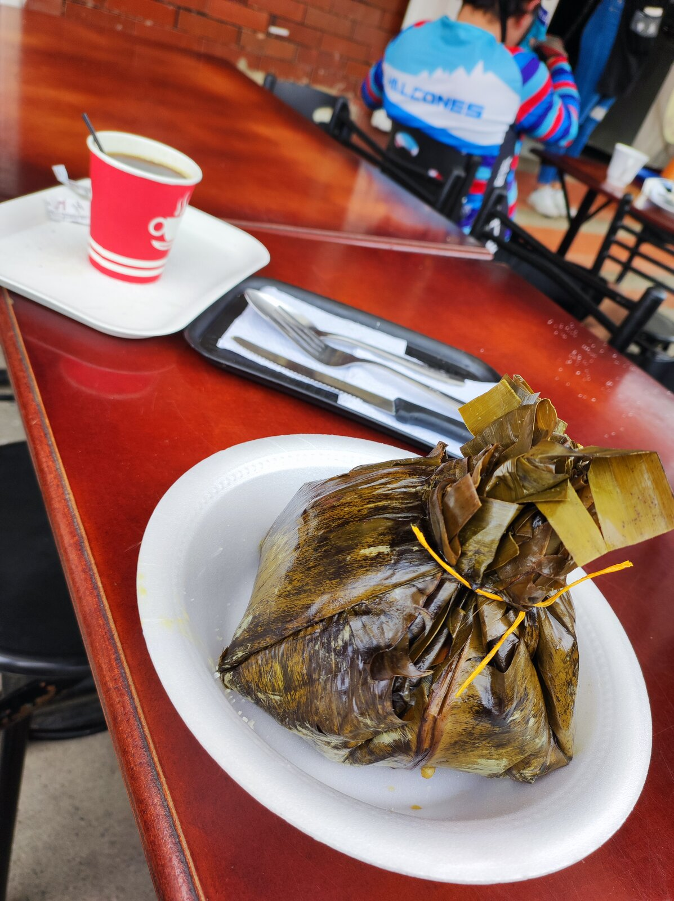
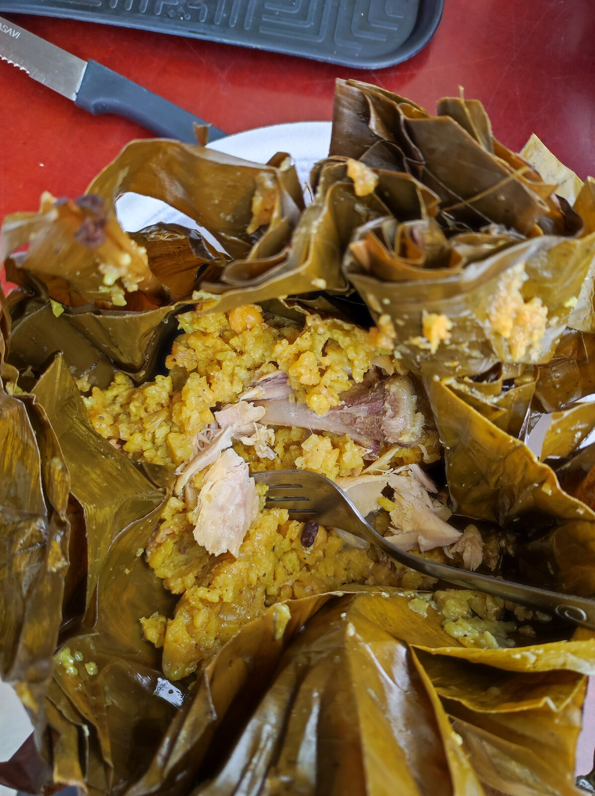
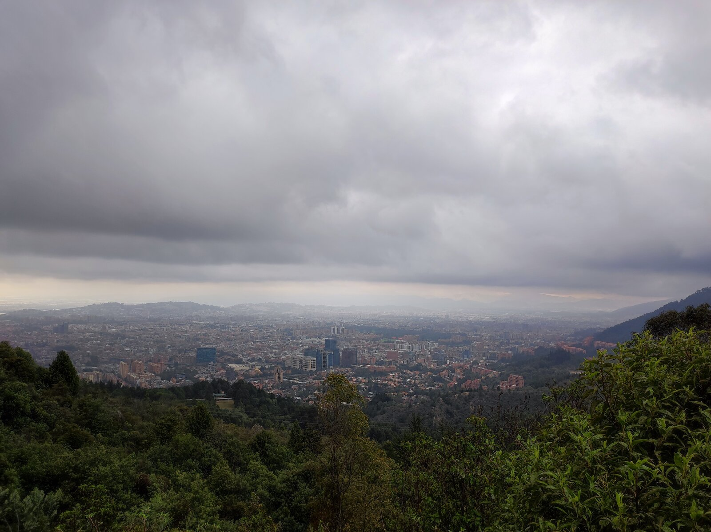
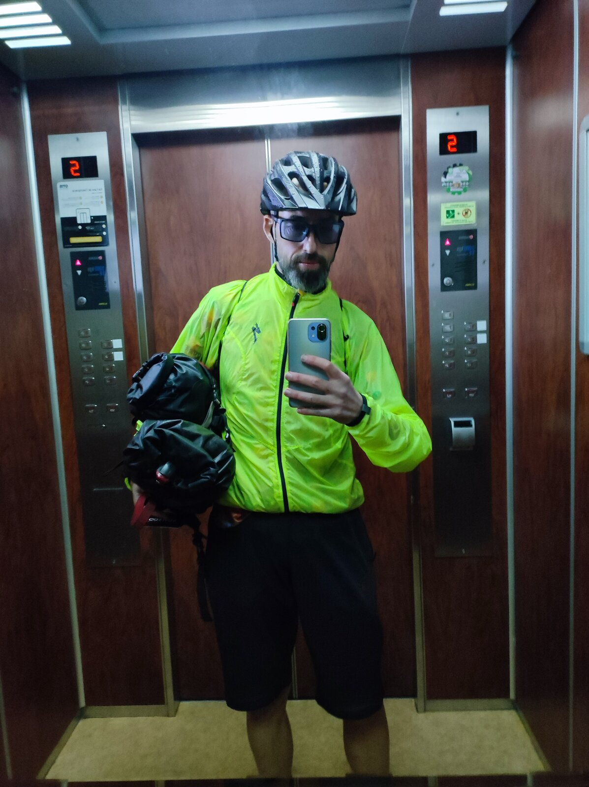
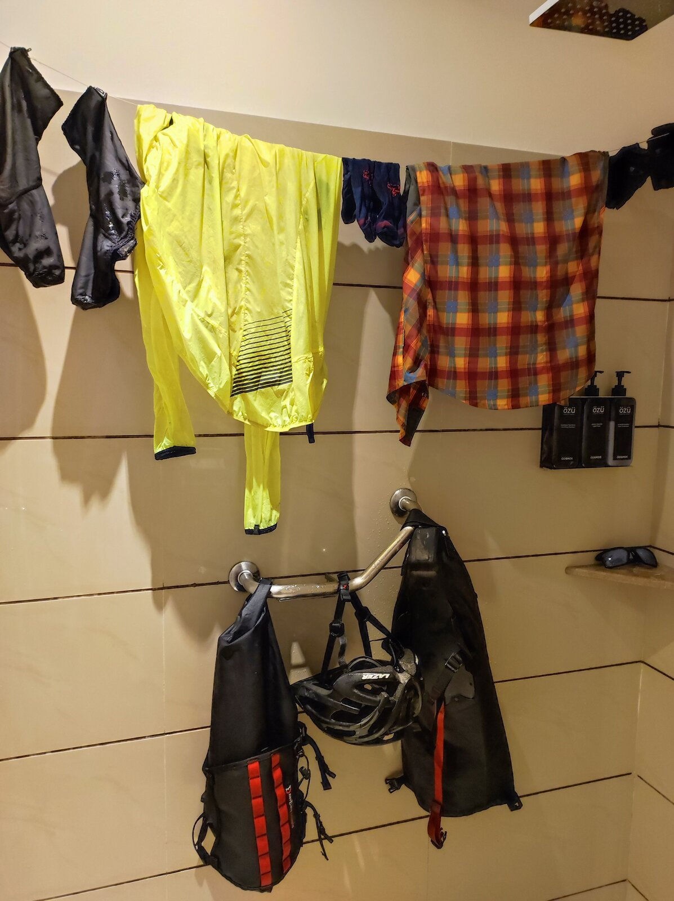

Ya solo quedaba el último día para volver a Bogotá. Con un café, fruta y galletas... ¿qué puede salir mal?

Salí dirección Guasca nuevamente para, al poco rato, coger la llamada Ruta Chingaza.

Esta ruta atraviesa el Parque Nacional Natural Chingaza, que se encuentra cerca de Bogotá. Este parque tiene una magnífica vegetación y unas preciosas vistas.

O eso creo, ya que esa lluvia que mantiene florida la vegetación no me abandonó durante todo el parque.

Después de aguantar la fina lluvia durante unas cuantas horas, llegué a La Calera, justo al punto donde en la primera etapa paré a tomar el café.

Y si tanto me gustó el sitio, ¿por qué no repetir? Pero esta vez ya venía con hambre: habían sido bastantes kilómetros y me apetecía algo más contundente.

Un magnífico <em>tamal</em> calentito para llenar la panza y quitar el frío del día.

Aunque bueno, tampoco hacía falta quitar el frío, porque nada más salir de La Calera me puse a subir, subir y subir. Es justo lo que hice el primer día, pero en sentido contrario, y no recordaba haber bajado tanto. Y es que las bajadas y las subidas se perciben de diferente manera.

Tras toda esta subida, llegué al Alto de Patios nuevamente, y esta vez apenas me detuve porque la lluvia amenazaba sobre Bogotá.

Pensé que me iba a librar. Pues no, no me libré. La lluvia me cogió muy fuerte durante la bajada. No sé si me mojaba más por la lluvia que caía del cielo o por lo que salpicaban mis ruedas, pero la verdad es que me empapé.

La llegada hasta el hotel fue todo un poema. Pero bueno, tampoco hacía mucho frío, así que no estuvo tan mal. Eso sí, tuve que tomar una foto en el ascensor del hotel para inmortalizar este momento.

Es una pena, la ruta se ha acabado. Pero, oye, la semana que viene tengo otra, y aún más larga. ¡Qué ganas de continuar pedaleando por Colombia!

