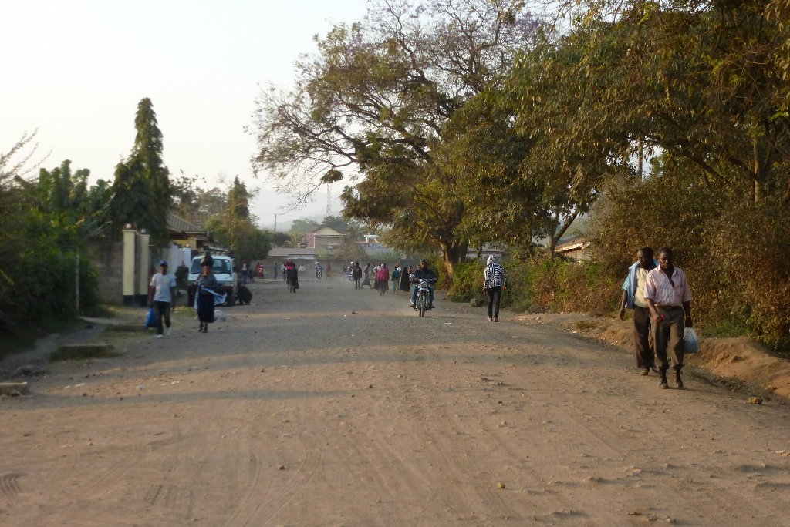
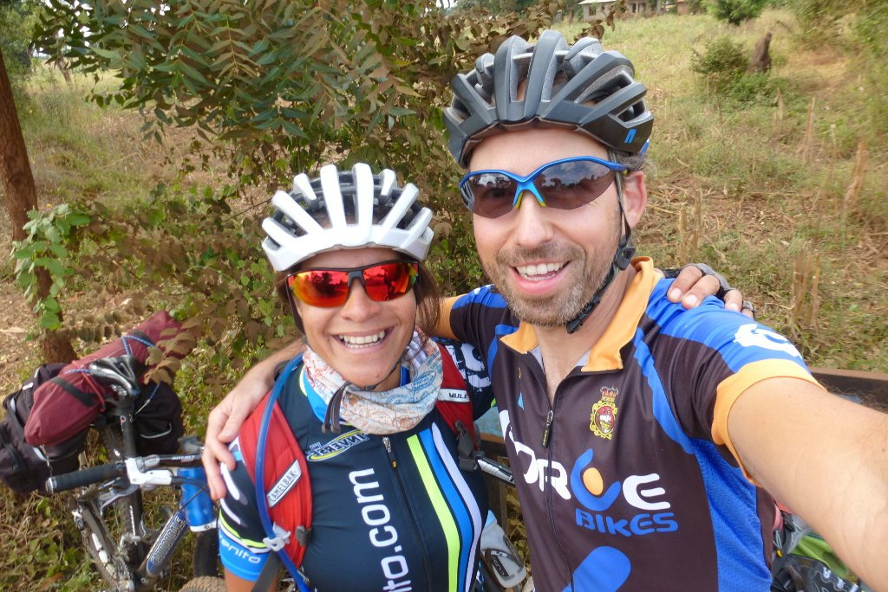
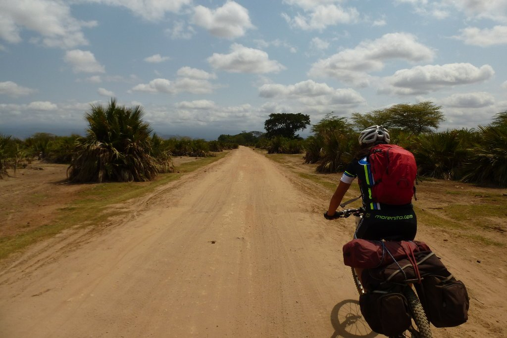
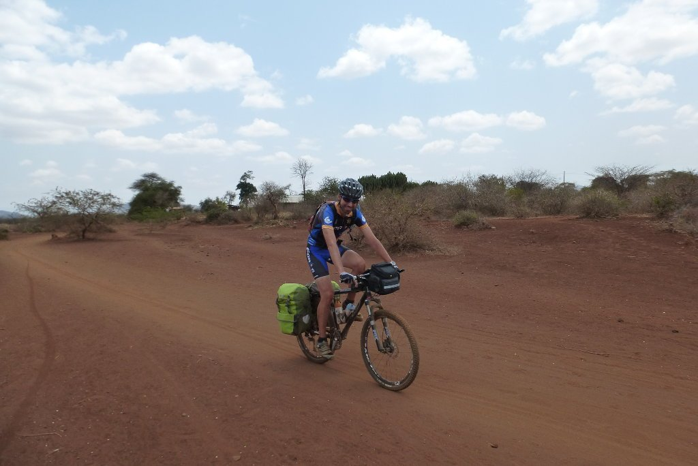
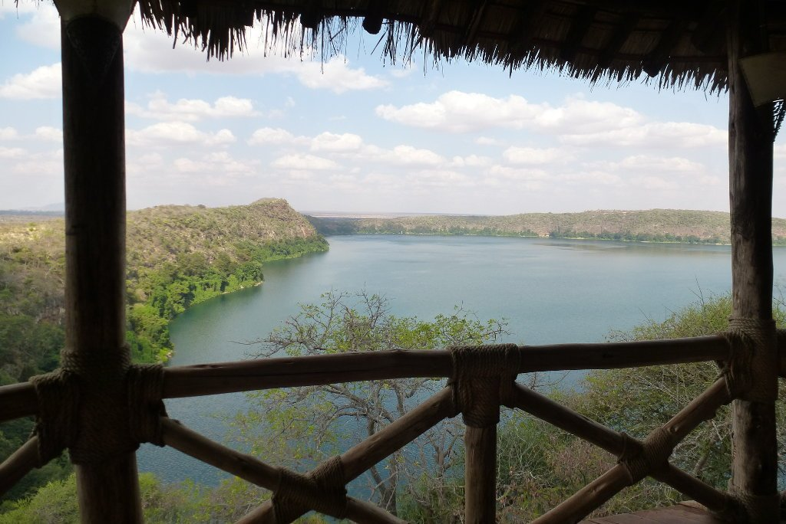
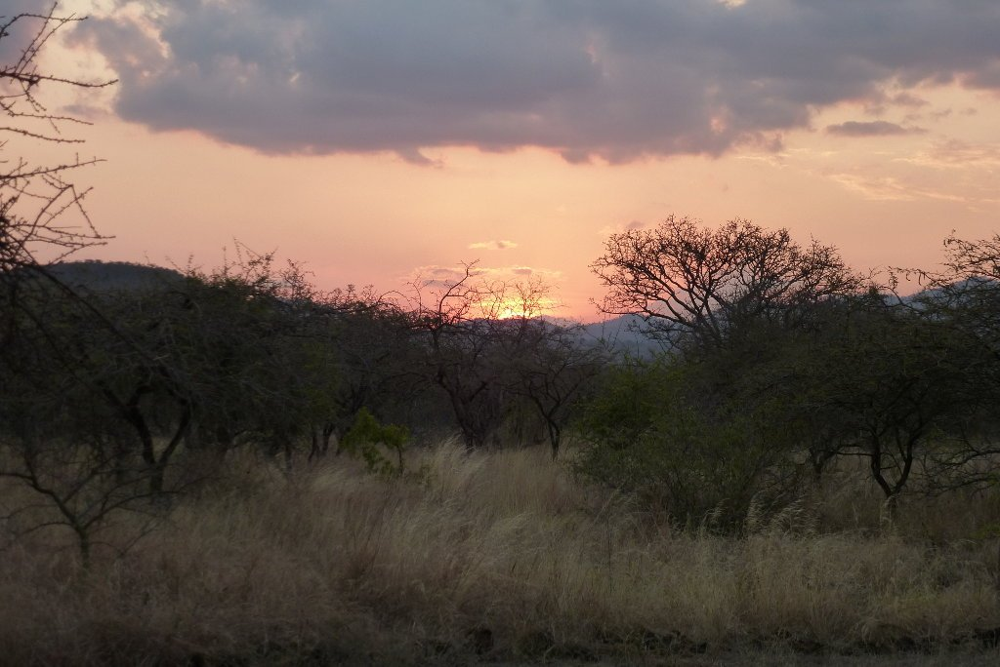

Por fin vamos a pedalear por Tanzania. Después de una llegada complicada, al ver que nuestras bicis no habían volado con nosotros y se habían quedado en algún aeropuerto (posiblemente en Nairobi), todo se solucionó. Desde el aeropuerto avisaron a Elisante, el encargado del hotel, de la llegada de las bicis a las oficinas que la compañía aérea tiene en Arusha, y éste nos gestionó un transporte para ir a por ellas. Aprovecho para darle las gracias a Elisante por la ayuda prestada, aunque no creo que me lea.

Y una vez solucionado todo, un transporte nos llevó hasta Moshi, lo que nos quitaba de en medio una fea y transitada carretera que no aportaba nada más que peligro y un día más de bici. El viaje comienza, ¡estamos listos!

Desde nuestro punto de salida comenzamos a circular por caminos, entre las humildes casas de las afueras de Moshi. El camino nos sorprendió mucho, esperábamos un terreno seco pero nos encontramos con mucha vegetación y, sobre todo, mucha gente. Se agradece ver vida por los caminos, y no tener que preocuparse por el agua y la comida es todo un lujo. Cada pocos kilómetros nos encontrábamos con algún bar donde poder comprar bebida y algún tipo de alimento. Aunque durante esta primera etapa no nos hizo falta ya que, por precaución, salimos bien cargados.

El camino estaba muy pisado y el firme era muy duro, lo que unido a un perfil ligeramente descendente nos permitía ir muy rápido, más incluso que por asfalto.

Kilómetros más adelante nos adentramos en una zona más desértica. La vegetación disminuye, así como la frecuencia de gente. El paisaje es maravilloso y nos encontramos con nuestras primeras acacias y nuestro primer baobab. No hay duda, estamos en África.

Salimos durante unos pocos kilómetros a la carretera para volver nuevamente a un camino. Pista dura en continuo ascenso, con mucha piedra y algún que otro camión. Y es que esta pista es la carretera principal que une todos esos pueblos.

Nos desviamos de la pista en un cruce a la derecha, rumbo al <a href="https://es.wikipedia.org/wiki/Lago_Chala">Lago Chala</a> por un camino descendente muy rápido. Felices por un lado, la gravedad juega a nuestro favor. Por otro lado... ¡mañana tendremos que subir por aquí!

Antes de llegar al Lago Chala toca pasar por el control de entrada. El entorno de este lago, una caldera volcánica situada entre Tanzania y Kenia, representa una reserva natural con entrada restringida previo pago de una tasa que sólo los turistas se pueden permitir. Pasar la noche en el entorno del lago no es barato para nosotros, con lo que entiendo que para los locales es prohibitivo. Además descubrimos que no muchos turistas deben llegar al lago sin un guía, porque la persona encargada de cobrar la tasa de entrada apenas habla inglés. Después de un rato, conseguimos pasar y llegar al lago. 80 kilómetros de etapa, nos lo hemos ganado.

Y mereció la pena. Un tranquilo lugar con unas bonitas vistas, y un camping confortable donde pasar la noche nos estaba esperando. Una buena cena y a dormir. Mañana nos espera un día largo.

