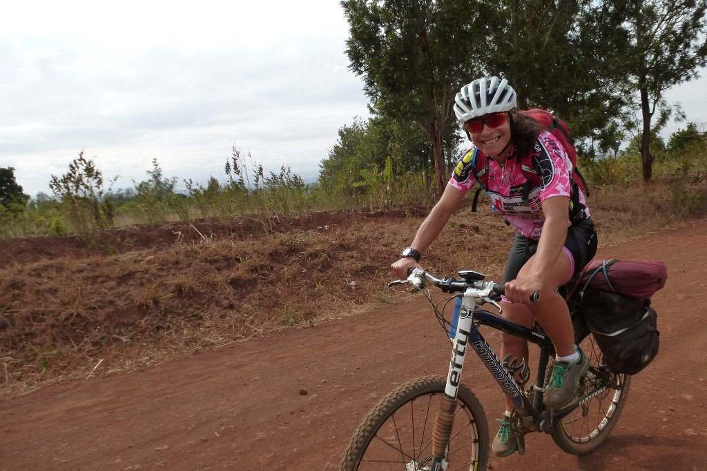
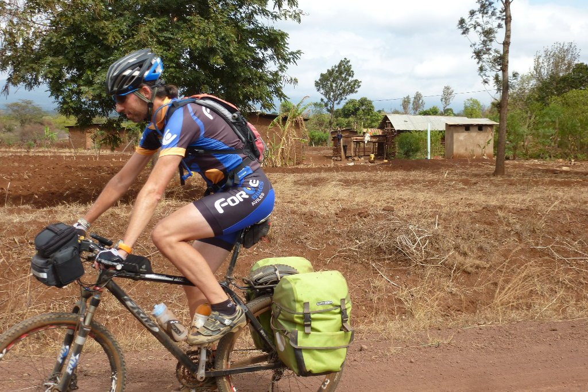
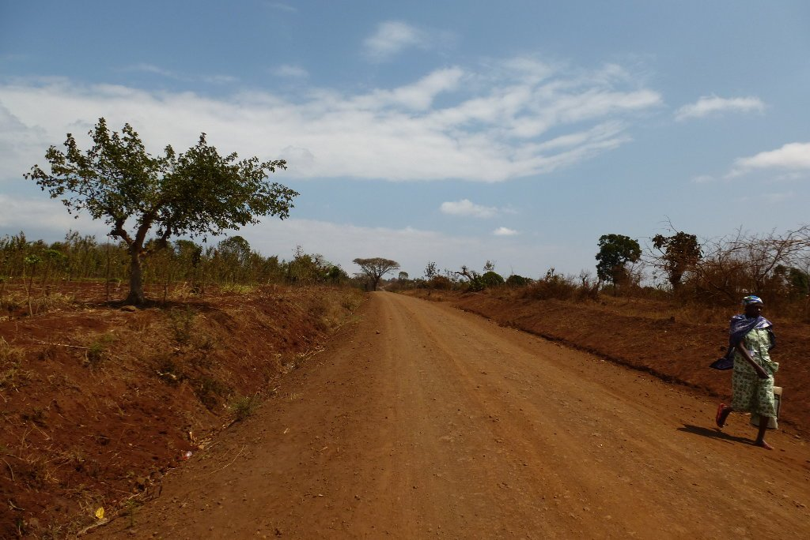
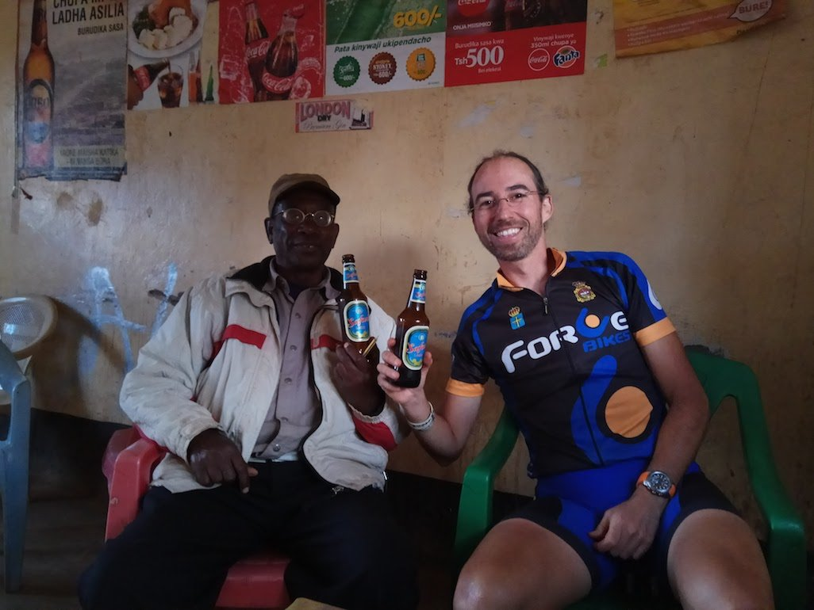
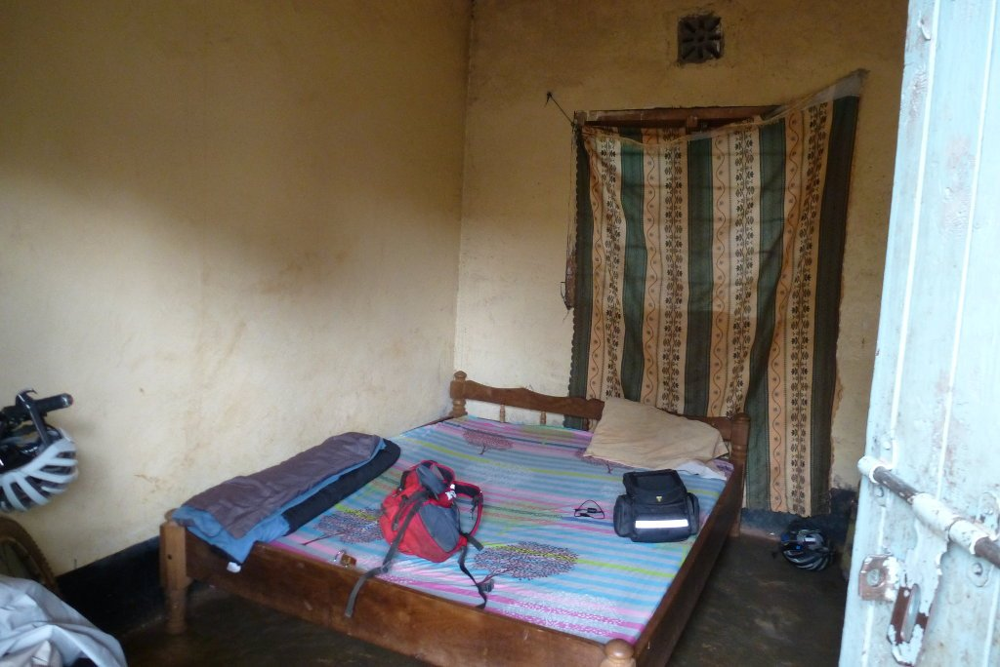
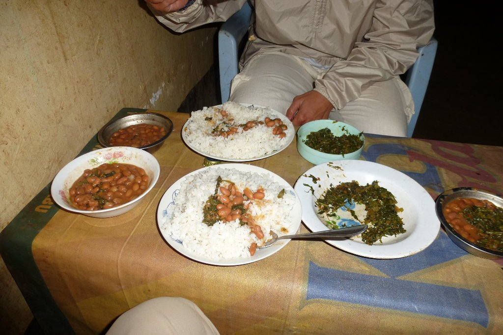

Hemos pasado una noche magnífica en el lago Chala. Nuestra primera noche de camping sin mosquitos, eso es una buena noticia. Aunque nuestro organismo va cargado de malarone, no tenemos ningún interés en probar su eficacia.

Ha sido una noche maravillosa, el lugar no puede ser más tranquilo y el único sonido que hemos oído ha sido el de algún ave nocturna. Tras desmontar la tienda, nos vamos a por el desayuno. Una tortilla de vegetales nos estaba esperando, frente a las preciosas vistas del lago Chala. Vamos a echar de menos este sitio...

Pero no hemos venido aquí a descansar, sino a montar en bicicleta. Así que cargamos las alforjas y nos lanzamos, camino arriba, hacia la pista que nos llevará a la parte norte del Kilimanjaro, la llamada <em>lower road.</em>

La pista va ganando altura poco a poco, nuestro destino de hoy está bastante alto. El terreno no está muy roto, pero ni de lejos representa el lujo del día anterior. Las rocas asoman entre la tierra y hacen que la marcha sea, por momentos, más incómoda de lo deseado. No nos cruzamos con ningún coche, tan solo motos. Muchas motos. Los famosos <a href="https://en.wikipedia.org/wiki/Boda_boda">boda boda</a>, los taxis más baratos (y más peligrosos) de África. Muchos nos adelantaron a gran velocidad, con sus viejas motos y ruedas lisas... no parecen muy seguros, y todos nos informaron de la cantidad de accidentes que provocaban.

Poco más adelante salimos a carretera asfaltada. Hoy tenemos muchos kilómetros que hacer, así que nos viene muy bien. Pasamos por varios pueblos con mucha vida, los que están en la frontera entre Tanzania y Kenia. El tráfico, sobre todo de camiones, es muy intenso, aunque rápidamente nos alejamos de esta zona y el tráfico disminuye.

La carretera asciende poco a poco, la etapa de hoy nos llevará desde los poco más de 900 metros del lago Chala hasta algo más de 2000. Afortunadamente, la carretera es buena y podemos avanzar con facilidad. La altitud se nota, empieza a hacer algo de frío y hasta nos llueve ligeramente. Estamos en la falda del Kilimanjaro pero seguimos sin verlo, las nubes lo tapan todo.

Tras ocho horas de bici llegamos a Kamwanga. Aquí nos estaba esperando <em>el profesor</em>, un maasai que trabaja como coordinador del <a href="http://kamwangaculturaltourism.weebly.com/">Centro Cultural de Kamwanga</a>. Esta sería la experiencia más auténtica del viaje. Y para empezar, una cerveza.

Nos alojamos en un modesto guest house. Tras una ducha, dejamos nuestros trastos por la habitación y nos vamos a conocer el pueblo.

El profesor nos llevó por todo el pueblo, presentándonos a la gente y contándonos cómo, y de qué, se vive en estas zonas. Evidentemente, la agricultura domina la economía de estos pueblos, sobre todo los plátanos. Por otro lado, nos sorprendió ver, en un pueblo tan pequeño, una mezquita, una iglesia católica y una iglesia protestante. Todos juntos, en un pequeño espacio, y en paz.

Tras la visita por el pueblo estamos hambrientos. Invitamos al profesor a cenar con nosotros nos damos un pequeño festín de comida local, muy muy buena. Y de aquí nos vamos para la cama, el día ha sido largo y necesitamos descansar. Lo que no sabíamos es que la noche iba a ser larga también... pero eso lo contaré en la próxima entrada.

