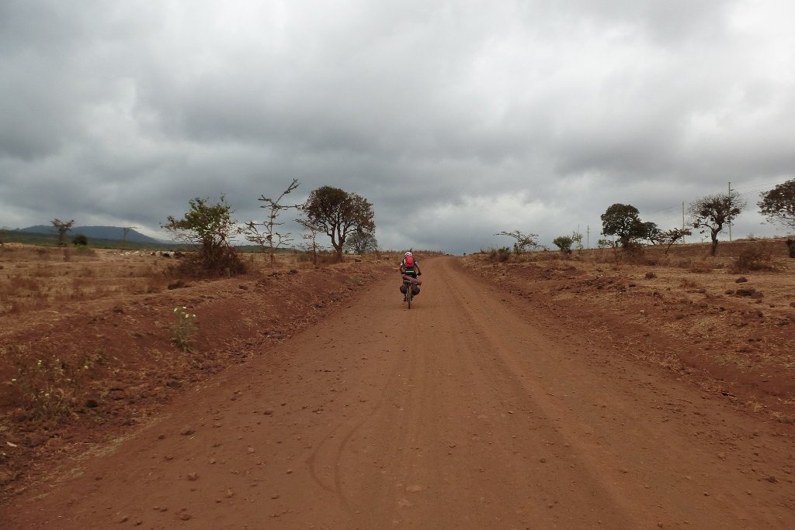
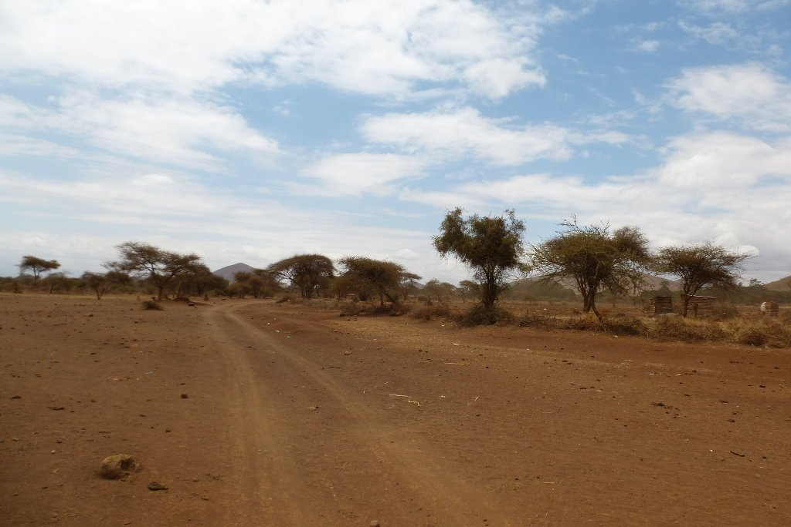
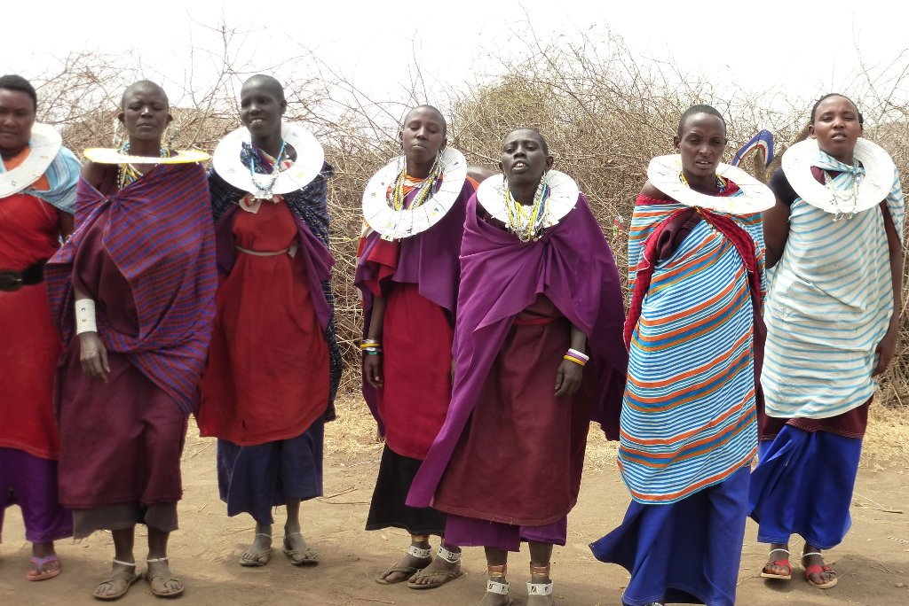
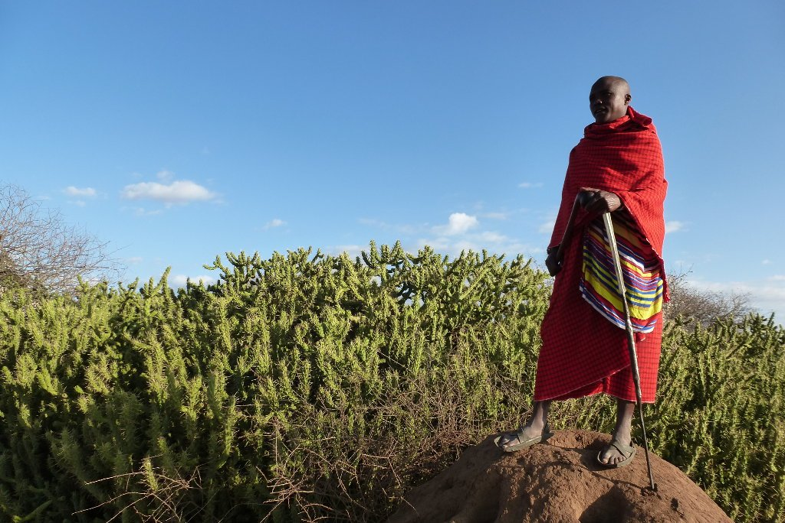
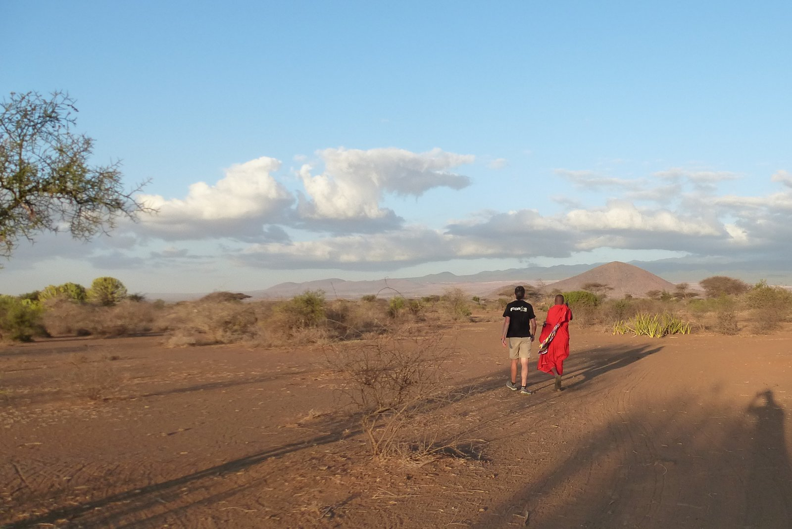
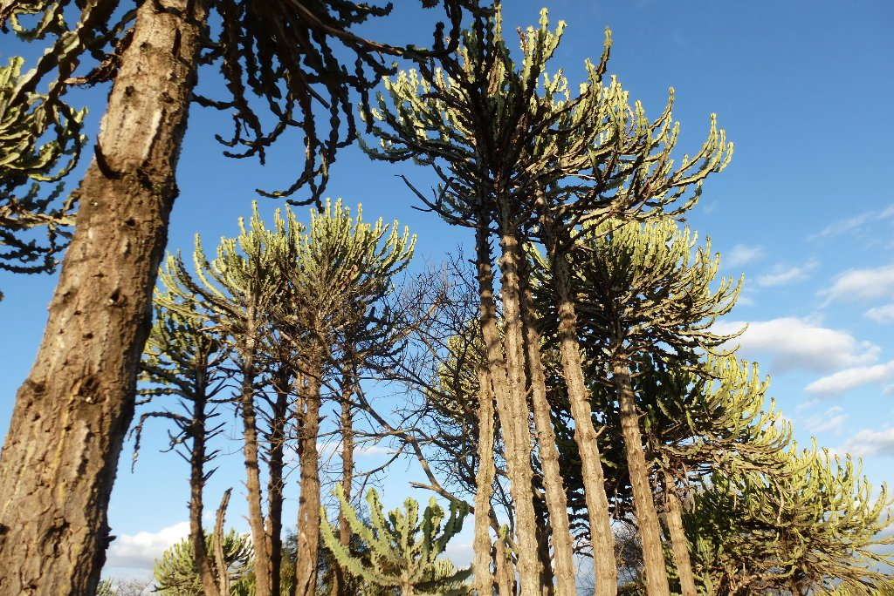
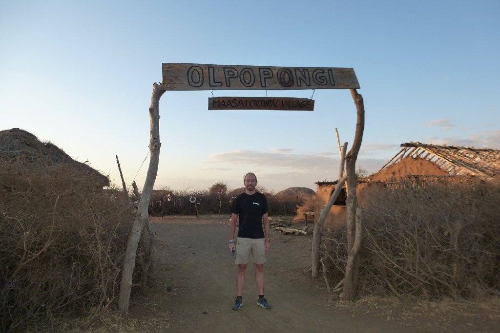
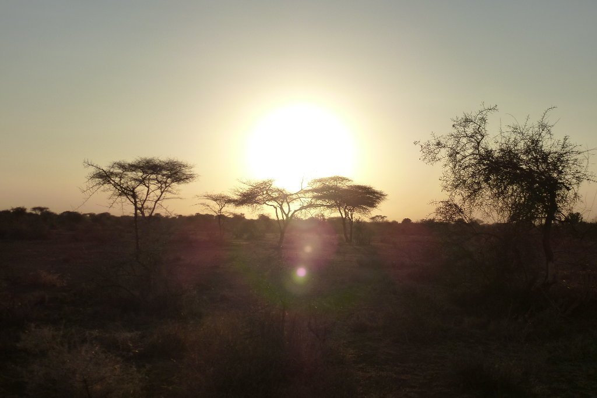

Hoy hemos ~~disfrutado~~ sufrido una noche complicada. Hemos elegido quedarnos a dormir en el centro neurálgico de la marcha nocturna. Hasta altas horas hemos escuchado, a todo volumen, la música de moda en esta zona. Después han venido las juergas nocturnas en las habitaciones contiguas... en resumen, no ha sido sencillo dormirse. Afortunadamente estábamos muy cansados y, aunque no hemos dormido todo lo que nos habría gustado, al final pudimos descansar.

A la mañana siguiente nos prepararon el que posiblemente sea mi desayuno más calórico hasta la fecha, a base de unos pancakes tan gordos que ni siquiera los podíamos enrollar. ¡Había que partirlos por la mitad! Y por si hubiésemos quedado con hambre, nos prepararon alguno más para llevar.

Ahora tocaba pagar: cena para tres, habitación para nosotros y desayuno para tres (nuestro guía se apuntó nuevamente) nos salió por 10€ en total. Y eso a precio para nosotros, los mzungu. O lo que es lo mismo, personas blancas.

He de reconocer que disfruto especialmente de estas experiencias. Nada de lo que allí vivimos se paga con dinero. Todo es fruto de estar en ese momento y ese lugar. Nunca olvidaré a nuestro querido profesor y lo bien que nos trató.

Llegó el momento de dejar Kamwanga. Salimos a la carretera y vemos que acaba justo a la salida del pueblo. De los aproximadamente 70 kilómetros de la etapa de hoy, tan solo haremos 200 metros de asfalto. Lo demás, pista polvorienta.

El cielo está nublado, lo que nos impide ver, nuevamente, el Kilimanjaro. Van pasando los días y seguimos sin verlo. No hay duda de que está ahí pero, ¿se dejará ver?

La pista no tiene tráfico y está muy, muy rota. Avanzamos unas horas hasta que llegamos a un punto donde empezamos a encontrarnos con muchos camiones y maquinaria. Parece que están tratando de convertir esta pista en una carretera. Lo que nos queda hasta que nos desviemos de las obras se convierte en un pequeño infierno. Grandes camiones adelantándonos, pasando muy cerca de nosotros, y levantando una cantidad de polvo tal que prácticamente nos obliga a parar. Una pequeña tortura que no empañará un día genial.

Más adelante nuestro camino se separa, al fin, de esta carretera en obras principal. Nos dirigimos a <a href="https://www.maasai-village.com/">Olpopongi</a>, una pequeña aldea maasai acondicionada para el turismo, que acepta huéspedes pero que está gestionada por maasai. Una aldea maasai que se reserva en Booking, muy extraño. Ya tenemos muchas, muchas ganas de llegar.

Lo que viene a continuación es maravilloso. Nos salimos de la pista y nos lanzamos, viento a favor, por unos caminos estrechos con un firme muy, muy duro que nos permite avanzar muy rápido. El paisaje es maravilloso y la pista, divertidísima. Hacemos dos pequeños altos en el camino. Uno, para curar las heridas que una <em>wait a bit thorn (<a href="https://es.wikipedia.org/wiki/Acacia_mellifera">Acacia mellifera</a>)</em> le causó a Nines en el brazo. Y es que, tanto nos liamos a correr, que ajustamos demasiado las curvas. La segunda parada fue para presentarle al guardia del parque nuestro pase.

Después de 65 kilómetros llegamos a la aldea. Ha sido una etapa corta pero incómoda. Y lo pasamos genial.

En la aldea nos reciben con un baile de bienvenida.

Tenemos polvo por todas partes, así que lo primero de todo es una ducha. Todo un lujo en un lugar como este, que no dispone ni de corriente eléctrica. La ducha, increíble, con preciosas vistas a toda la sabana. Tras la merecida ducha, las experiencias en la aldea se suceden. Primero, una visita al museo etnográfico de la aldea. Después, un maravilloso trekking alrededor de la aldea, donde el jefe nos muestra toda una serie de datos y curiosidades acerca de la cultura maasai.

Historia maasai, cultura, tradiciones, y hasta cómo fabricar un cepillo de dientes con las ramas de una acacia.

Y cómo no, el motivo por el que la aldea se llama Olpopongi. Coge su nombre del Olpopongi (nombre en maa), el árbol con el que construyen sus chozas. Al parecer, es tóxico para los insectos, con lo que se ahorran unas buenas capas de barniz.

También tratamos de ascender al rango de maasai, el cual se consigue mostrando tu habilidad con la lanza. Y fracasamos estrepitosamente. Después, un té maasai con la anciana de la aldea, otra gran experiencia. Sin duda, será un día que no olvidaremos jamás.

De vuelta a la aldea, una buena cena con cerveza (¡sí, tenían cerveza!) y a dormir en una confortable choza. ¡Buenas noches!

