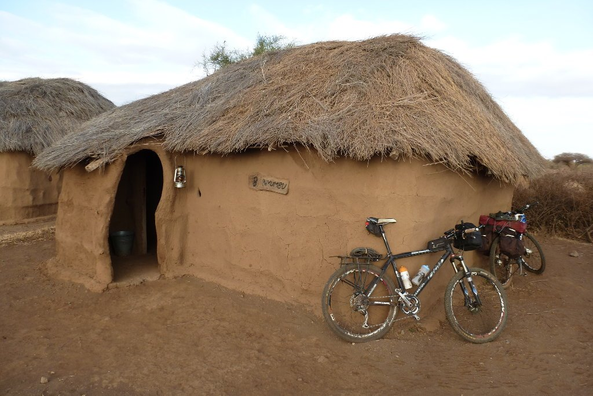
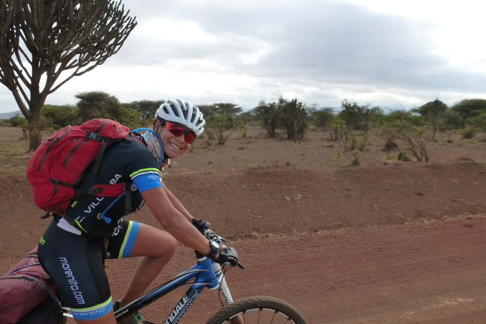
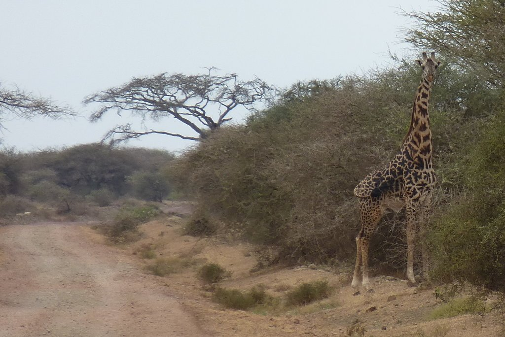
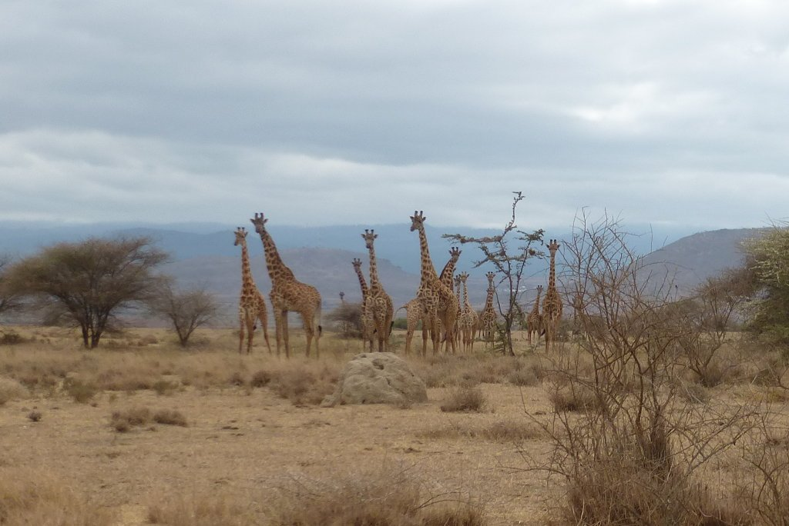
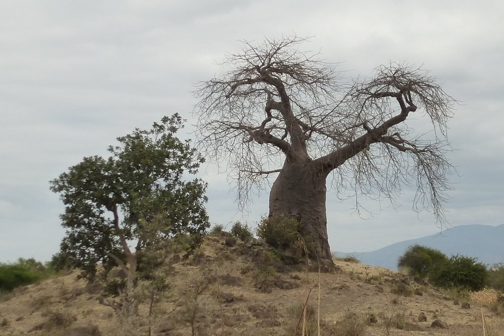
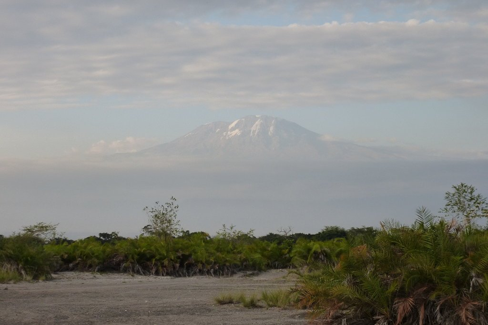
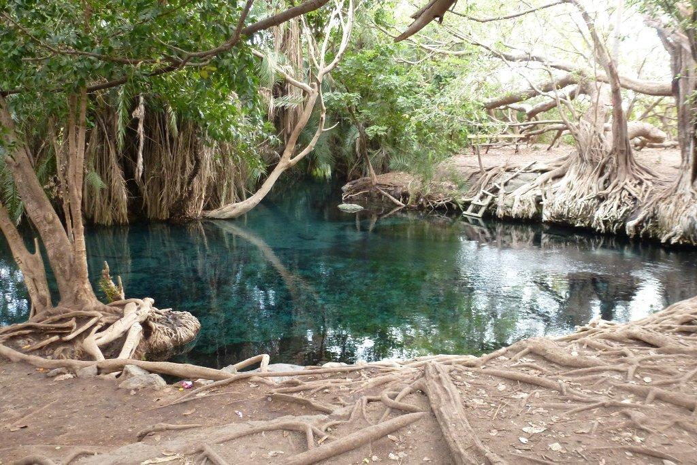

¡Menuda noche! Hoy sí que hemos descansado, y en uno de los mejores lugares para hacerlo. En medio de la sabana tanzana, muy cerca de Kenia, en una <strong>confortable</strong> choza de barro y ramas. Y recalco lo de <strong>confortable</strong>, porque realmente, lo era.

Silencio absoluto, una cama hecha con ramas pero muy cómoda, y un pequeño tragaluz en la pared que permitía ver la salida del sol. En resumen, no se me ocurre un lugar mejor en el que descansar.

Nuevamente, un buen desayuno para arrancar el día y salimos hacia Kikuletwa. Después del tramo infernal de ayer, en obras, donde nos tuvimos que pelear con un montón de camiones, hoy nos apetecía un poco más de tranquilidad. La primera parte de la ruta es tranquila, deshacemos el camino andado hacia Olpopongi y salimos a una pista que nos lleva hacia la carretera que rodea el Kilimanjaro.

Y de repente, la sorpresa del día. Como ciclista, uno está acostumbrado a que los animales se crucen en el camino. No es raro encontrarse, en según qué zonas, con corzos o jabalíes que huyen, o incluso se pasean por delante sin importarles quién venga. Y siempre te arrancan una sonrisa. Pero no hay corzos ni jabalíes en Tanzania. Esta vez fue una jirafa la que se cruzó en nuestro camino.

He de confesar que la imagen no representa para nada lo que sentimos. Esta fue la primera vez que vimos una jirafa en libertad, y nos pareció impresionante. Me temblaba el pulso y era incapaz de sacar mi cámara. No por miedo (aunque un poco de respeto sí que da, es muy grande...) sino por los nervios de ver a tan maravilloso animal, mirándonos fijamente, pensando tal vez que éramos una especie de marcianos, con nuestra piel blanca y nuestra ropa ajustada de colores chillones.

Miramos a nuestra izquierda y vemos un grupo de jirafas, mirándonos fijamente desde la altura. Parecían submarinistas, asomando de forma simpática su cabeza sobre el horizonte. Sus orejas y pequeños cuernos nos hacen sonreír. No sabemos cuántas hay, pero no menos de una treintena.

Vemos también un grupo de cebras. Pero nuestra atención sigue con las jirafas. Nos acercamos poco a poco, y a esa misma velocidad se va a alejando nuestra amiga. A lo lejos, unos niños la asustan y vemos como se aleja corriendo. Sus movimientos parecen ir a cámara lenta, pero desaparece de nuestra vista en muy poco tiempo.

Esta experiencia bien merece un viaje. Tenemos la energía a tope para continuar la ruta.

Seguimos por la pista y, poco más adelante, salimos a una carretera asfaltada, que es bienvenida por nuestros maltrechos traseros. Avanzamos a buena velocidad, atravesando multitud de pueblos. Hacemos alguna parada para hidratarnos (qué buena está la Fanta piña, por cierto).

Poco más adelante atravesamos la transitada carretera que une Arusha con Moshi, y nos salimos nuevamente a una pista bastante rota. Se acabó la comodidad.

Estamos doloridos. No hay duda de que esta pista nos está haciendo daño. Afortunadamente no nos queda demasiado para destino y, aunque la pista no es muy bonita, nos deleita con alguna bonita imagen. Como la de este baobab, imagen inconfundible de África.

Días más tarde íbamos a tener oportunidad de probar su fruto. Aviso, ¡está bastante malo!

Finalmente llegamos a Rundugai. Habíamos quedado con Ndoss, el responsable de <a href="http://rundugaiculturaltourism.com/" target="_blank" rel="noopener">Rundugai Cultural Tourism</a>. Al parecer, el gobierno de Tanzania intenta promover el turismo más allá de las grandes agencias organizadoras de safaris, en un intento por dar visibilidad y oportunidades de trabajo a la gente local. Y en Rundugai lo hacen bastante bien.

Ndoss nos explica el programa de dinamización existente en Rundugai, que va desde las visitas guiadas, a alojamiento y comida con la gente de la zona. Pero nosotros hemos venido con otra idea, que es la de pasar una noche de camping en Kikuletwa hot spring. Así que Ndoss llama a un boda boda y nos dirigimos a Kikuletwa. Y sí, casi se nos olvida, ¡por fin el cielo se abrió y vimos el Kilimanjaro!

Kikuletwa hot spring es una pequeña charca de agua termal que brota como un oasis en medio de una zona muy árida. Nos encontramos ante una vegetación casi selvática en medio de un extenso secarral. El lugar es precioso, y tendremos la oportunidad de pasar la noche aquí.

Pero no nos engañemos. Hoy, 10 de septiembre de 2017, es domingo. Y los domingos, estés donde estés, hay mucha gente. Kikuletwa está lleno de gente, mayoritariamente turistas, y el lugar dista mucho de ser el lugar tranquilo y apacible que esperábamos. Tendremos que esperar a que den las siete y cierren las puertas, para quedarnos tranquilos.

Y así fue. Tras un relajante baño, montamos nuestra tienda y nos quedamos solos con el guarda que cuida esta zona. Nos preparamos algo de cena que degustamos alrededor de una improvisada hoguera. Mañana, vuelta a Arusha.
