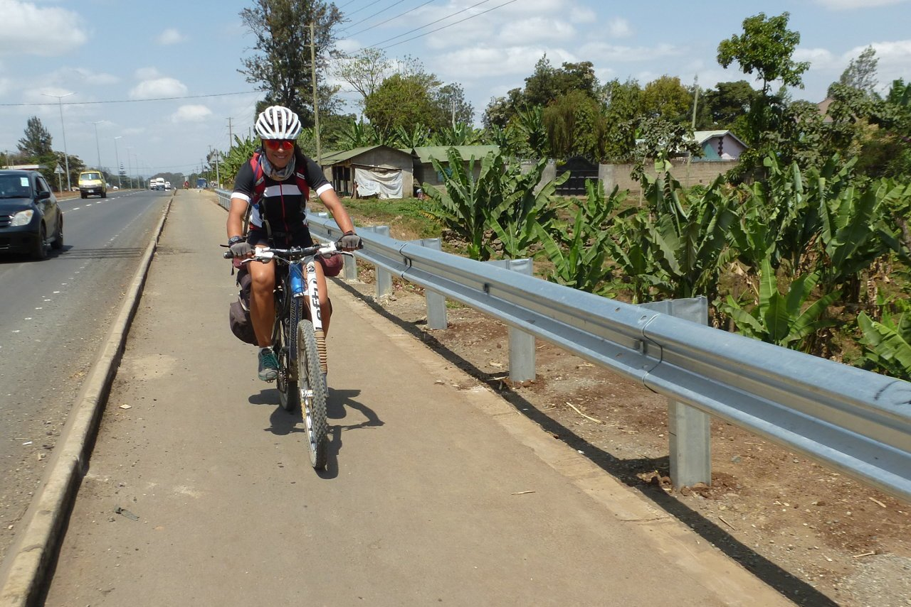

Despertamos bien temprano tras una tranquila noche acompañada por los sonidos de los animales, sobre todo monos, que correteaban por encima de la tienda. Momentos impagables que somos afortunados de disfrutar.

Salimos temprano rumbo a Arusha. Va a ser un día tranquilo, tenemos una pequeña zona de caminos y después saldremos a la carretera que une Moshi con Arusha. Es una carretera muy transitada, ¡esperemos no tener muchos problemas!

Salimos tranquilamente, ya se van notando los días y los kilómetros, y el terreno está muy, muy roto, y nuestros cuerpos piden descanso. Desandamos lo andado el día anterior, volviendo sobre nuestros pasos hasta la carretera, donde tomamos rumbo Arusha. La carretera es un continuo sube-baja, con más tráfico del que nos gustaría. Pero al menos, el firme es muy bueno.

A medio camino hacemos una pequeña parada en un bar de carretera para beber y comer algo. Allí hablamos con un chico que habla inglés bastante bien. Tiene un pie escayolado, se lesionó jugando al fútbol. Nos habla de las ganas que tiene de volver a jugar, cómo sueña con jugar en Europa y labrarse un futuro como futbolista. Nos habla con mucha ilusión, y lo cierto es que ese futuro, aunque improbable, es prácticamente el único futuro prometedor que puede tener. En caso contrario su futuro será feliz, seguro, pero no podrá realizar los sueños que nos ha contado.

Tras mucho tráfico y mucho calor llegamos a Arusha, al mismo hotel del que habíamos salido. Y en el que nos han cuidado muchísimo. Elisante nos ha cuidado bien, y a nuestra vuelta ya teníamos nuestras maletas en la habitación. Lo agradecemos mucho, después de todo han sido 71 kilómetros con perfil ascendente en nuestro último día. Nos hemos ganado la ducha.

No sé cómo concluir esta narración. El viaje ha sido alucinante. El paisaje espectacular. Y la gente, como en cualquier país (esto no es ninguna novedad) acogedora y siempre bienintencionada.

Nos quedan unos días de safari, ya en modo turista convencional, para cargar nuestra retina (y nuestro carrete) de fotografías. Pero si la bici acaba aquí, la historia acaba aquí. ¡Hasta la próxima!
